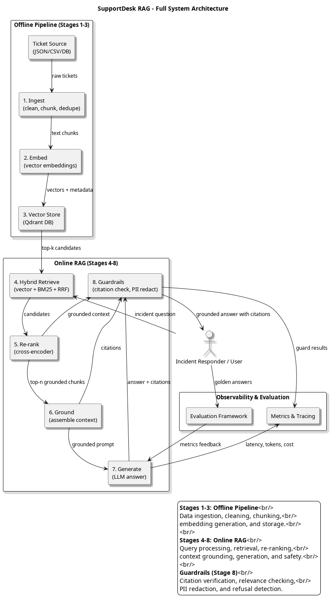
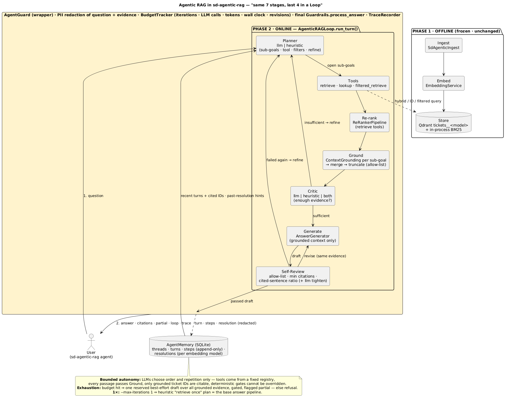
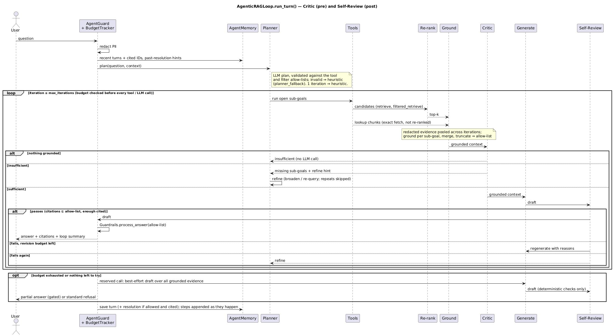
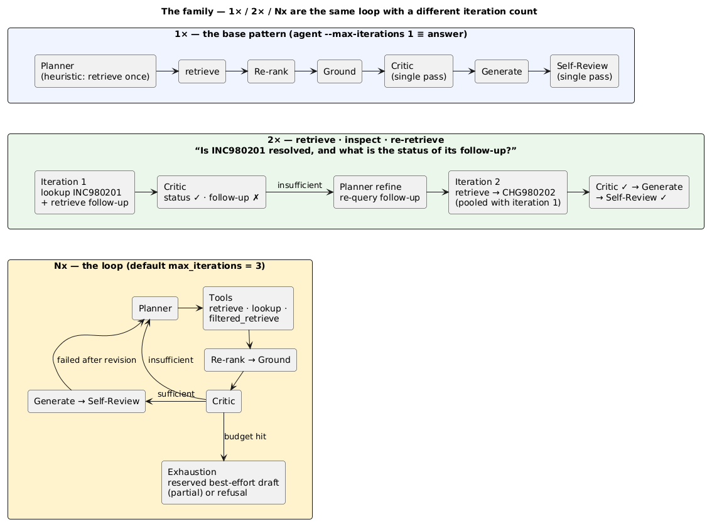

# SD Agentic RAG

A Production-Ready RAG (Retrieval-Augmented Generation) system for support desk tickets. Built with LangChain, OpenAI, and Qdrant, it helps answer customer support queries with grounded, cited answers from your ticket history.

---

**✨ Features**
- **7-Stage RAG Pipeline**: Ingest → Embed → Store → Retrieve → Re-rank → Ground → Generate
- **Hybrid Search**: Combines vector similarity with BM25 keyword matching
- **Citation-Verified Answers**: Every claim is traced back to source tickets
- **Smart Triage**: Automatically categorize and prioritize incoming tickets
- **Bulk Analysis**: Process and group multiple tickets
- **Guardrails**: Citation enforcement, relevance checking, PII redaction, and configurable refusal handling
- **Observability**: Full tracing and metrics collection
- **Evaluation Framework**: Measure answer quality, hallucination rates, and relevance
- **Agentic Loop** (`agent`): the same stages, with Retrieve → Re-rank → Ground → Generate run in a bounded loop that a Planner controls, a Critic and a Self-Review keep honest, Memory feeds and a Guard wraps ([design](docs/Agentic_RAG_same_7_stages_last_4_in_a_Loop.md))

---

## Table of Contents

- [Part 1: User Guide - How to Use the System](#part-1-user-guide-how-to-use-the-system)
  - [Before You Start](#11-before-you-start)
  - [CLI Commands](#12-cli-commands)
  - [Examples](#13-examples)
- [Part 2: Developer Guide](#part-2-developer-guide)
  - [Setting Up Your Environment](#21-setting-up-your-environment)
  - [Architecture Overview](#22-architecture-overview)
  - [Module Reference](#23-module-reference)
  - [Testing](#24-testing)
  - [Model Configuration](#25-model-configuration)
  - [Agentic RAG Loop](#27-agentic-rag-loop)

---

# Part 1 - User Guide: How to Use the System

## 1.1 Before You Start

You need:

- **Python 3.14+** (use `pyenv` to install)
- `uv` for package management
- The project set up as described in [Setting up your environment](#21-setting-up-your-environment)
- Required API keys in a file named `.env` in the project folder

### Environment Setup

```bash
# Copy environment file and edit with your keys
cp .env.example .env
nano .env  # Add your OpenAI or Ollama configuration
```

Required environment variables:

```bash
# OpenAI Configuration
OPENAI_API_KEY=sk-...

# Or use Ollama (local models)
# USE_OLLAMA_MODELS=true
# OLLAMA_BASE_URL=http://localhost:11434/v1
# OLLAMA_EMBEDDING_MODEL=qwen3-embedding:latest
```

### Required Services

The system uses **Qdrant** as the vector database for storing and retrieving embeddings. Make sure Qdrant is running before using the system.

#### Starting Qdrant

```bash
# Start Qdrant container (in another terminal)
./scripts/qdrant-db.sh --start

# Wait for Qdrant to be ready (optional, auto-waits up to 30 seconds)
./scripts/qdrant-db.sh --wait

# Check status
./scripts/qdrant-db.sh --status

# Stop Qdrant when done
./scripts/qdrant-db.sh --stop
```

#### Configuration

The system uses a YAML configuration file at `config/config.yaml` with settings for:

- **OpenAI**: API key environment variable, embedding model, and batch size
- **Ingest**: Chunking parameters (size, overlap, strategy), PII cleaning, and chunk header options
- **Embed**: Embedding model and batch size
- **Store**: Qdrant connection settings (host, port, collection name prefix)
- **Retrieve**: Vector search weights and hybrid retrieval parameters
- **Re-rank**: Re-ranking model configuration
- **Ground**: Maximum passages and token limits
- **Guard**: Citation enforcement, relevance checking, PII redaction, and refusal handling
- **Logging**: Log level and format

##### Guard Configuration

The **Guard** section controls answer enforcement:

```yaml
guard:
  enable_citation_check: true      # Require citations in answers
  enable_relevance_gate: true      # Check relevance to query
  enable_pii_redact: true          # Redact personally identifiable information
  enable_safety_filter: false      # Detect unsafe/sensitive content
  enforce: true                    # Block non-compliant answers (use false for permissive mode)
  min_citations_per_answer: 1      # Minimum number of citations required
  max_tokens: 2000                 # Maximum answer length in tokens
  min_tokens: 10                   # Minimum answer length in tokens
  relevance_threshold: 0.5         # Minimum relevance score to pass
```

**Enforcement Behavior**:
- When `enforce: true`: Non-compliant answers are replaced with a standard refusal message
- When `enforce: false`: Answers pass through regardless of guard results
- **Refusals** ("I cannot find sufficient information...") are exempt from citation count and length checks
- **Output** includes a `guard` object with `allowed`, `enforced`, `replaced`, and `actions` fields

##### Per-Model Collections

The vector collection name is automatically suffixed with the embedding model name to support multiple embedding providers:

- **Default prefix**: `tickets`
- **Effective name format**: `tickets__<model-slug>`
- **Model slug**: Lowercased with non-alphanumeric characters replaced by `-`

**Examples**:
- `text-embedding-3-small` → `tickets__text-embedding-3-small` (1536 dimensions)
- `qwen3-embedding:latest` → `tickets__qwen3-embedding-latest` (4096 dimensions)
- Explicit `collection_name=` argument bypasses suffixing (useful for tests)

When a collection exists but has different dimensions than expected, the system raises a clear error with the collection name, actual dimensions, and the remedy (`ingest --wipe`).

##### Dimension Resolution

Embedding dimensions are determined automatically from the active model:

1. **Explicit override**: `openai.embedding_dimensions` in config (legacy, not recommended)
2. **Known models map**: Look up model name from `model_selector.get_embedding_model()`
3. **One-time probe**: Embed a short string and measure vector length

Known model dimensions:
- `text-embedding-3-small`: 1536
- `text-embedding-3-large`: 3072
- `text-embedding-ada-002`: 1536
- `nomic-embed-text`: 768
- `qwen3-embedding:latest`: 4096

**Note**: The explicit dimension override is deprecated. Use per-model collections instead.

#### Database Setup and Data Ingestion

Before you can answer questions, you need to load your ticket data into the vector database:

```bash
# Ingest tickets from the synthetic tickets file
sd-agentic-rag ingest --data-path data/synthetic_tickets.json

# For custom tickets, use your own JSON file with the same structure
sd-agentic-rag ingest --data-path data/your-tickets.json

# Wipe and re-ingest data (clears existing data first)
sd-agentic-rag ingest --data-path data/synthetic_tickets.json --wipe
```

**Data Format**: Your tickets file should be a JSON file with a `tickets` array containing ticket objects. Each ticket should have fields like `ticket_id`, `title`, `description`, `service`, `severity`, and `status`. See `data/synthetic_tickets.json` for the complete schema.

**Note**: If you see `Connection refused` errors, ensure Qdrant is running first with `./scripts/qdrant-db.sh --start`.

---

## 1.2 CLI Commands

The `sd-rag` CLI provides various commands for working with support tickets:

### Basic Usage

```bash
# Show all available commands
sd-agentic-rag --help

# Show help for a specific command
sd-agentic-rag answer --help
```

### Available Commands

| Command | Description |
|---------|-------------|
| `answer` | Answer support questions with citations |
| `agent` | Answer through the agentic loop (plan, retrieve, check, revise) with memory |
| `evaluate` | Evaluate RAG responses with metrics against ground truth |
| `triage` | Automatically categorize and prioritize incoming tickets |
| `similar` | Find similar past tickets to the current issue |
| `escalate` | Generate escalation handoff summaries |
| `runbook` | Find runbook procedures for incidents |
| `gap` | Detect knowledge gaps in support tickets |
| `bulk` | Process and analyze multiple tickets at once |
| `ingest` | Load and index ticket data into the vector store |
| `qdb` | Query Qdrant database directly (debugging) |

### Command Details

#### `answer` - Answer Support Questions

```bash
# Basic usage
sd-agentic-rag answer --prompt "How do I reset my password?"

# With more results
sd-agentic-rag answer --prompt "Network timeout issues" --top-k 10

# JSON output for automation
sd-agentic-rag answer --prompt "Database connection failed" --json

# Verbose mode
sd-agentic-rag answer -p "Server downtime" -v
```

**Output**:
Markdown with citations like `[CITATION:INC001]`. Use `--json` for structured output:

```json
{
  "answer": {
    "answer": "...the actual answer text...",
    "citations": ["CITATION:INC001", "CITATION:INC002"]
  },
  "grounded_context": {
    "passages": [...],
    "citations": [
      {"ticket_id": "INC001", "score": 0.95, "retriever": "vector"}
    ]
  },
  "guard": {
    "allowed": true,
    "enforced": true,
    "replaced": false,
    "actions": []
  }
}
```

**Guard Fields**:
- `allowed`: Passes all guard checks
- `enforced`: Enforcement was active (`guard.enforce: true`), whether or not it fired
- `replaced`: The answer was blocked and replaced with the standard refusal message
- `actions`: List of guard checks applied

#### `agent` - Answer Through the Agentic Loop

`agent` answers through a bounded loop: Planner → Tool → Re-rank → Ground → Critic →
Generate → Self-Review, wrapped by the Guard. It handles questions that need more than
one piece of evidence ("is LAT001234 resolved and what was its SLA?"), follow-ups
("what was its resolution?") and a first retrieval that misses. `answer` is unchanged
and remains the single-pass baseline. See [Agentic RAG Loop](#27-agentic-rag-loop) for
how it works.

```bash
# Single turn
sd-agentic-rag agent --prompt "Is LAT001234 resolved and what was its SLA?"

# Per-iteration trace (plans, tool calls, Critic / Self-Review verdicts, fallbacks)
sd-agentic-rag agent --prompt "Why are API calls slow?" --verbose

# Follow-ups in a thread, even across separate processes
sd-agentic-rag agent --thread-id demo --prompt "Why are API calls slow?"
sd-agentic-rag agent --thread-id demo --prompt "What was its resolution?"

# Start the thread's conversation over (earlier turns stay in the audit)
sd-agentic-rag agent --thread-id demo --new --prompt "Replica lag on DB01?"

# Interactive chat: one question per line, `exit`/`quit` or end of input to stop
sd-agentic-rag agent --chat --thread-id demo

# The thread's current conversation, and every stored loop step
sd-agentic-rag agent --history --thread-id demo
sd-agentic-rag agent --audit --thread-id demo --full

# Base-pipeline cost and behavior, no memory, JSON
sd-agentic-rag agent --prompt "Why are API calls slow?" --max-iterations 1 --no-memory --json
```

| Option | Description |
|--------|-------------|
| `--prompt/-p`, `--chat`, `--history`, `--audit` | Mode - exactly one is required |
| `--full` | With `--audit`: untruncated step text |
| `--thread-id` | Conversation thread (default `default`) |
| `--new` | Start a fresh conversation in the thread (in `--chat`, applies to the first turn) |
| `--max-iterations N` | Loop iterations, N >= 1 (default `agent.budget.max_iterations` = 3); 1 = the base pipeline |
| `--top-k` | Passages per tool call (default `agent.top_k` = 5) |
| `--no-memory` | Neither read nor write memory; the database is not created |
| `--db PATH` | Memory database; default `$SD_AGENTIC_MEMORY_DB`, else `agent.memory.db_path` (`data/sd_agentic_memory.sqlite`, git-ignored) |
| `--config`, `--json`, `--verbose/-v`, `--debug` | As for the other commands; `--json` is not available with `--chat` |

**Output**: the answer, its citations (ticket ID, score, retriever, tool), the Guard
verdict and a loop summary (iterations, LLM calls, tokens, elapsed time, stop reason).
`--json` prints one object with `answer`, `citations`, `partial`, `guard`, `loop` and
`trace` (plus `grounded`, `iterations`, `stop_reason`, `thread_id`, `turn_no`).

**Budget and `partial`**: every turn is capped (iterations 3, LLM calls 12, tokens
20000, wall clock 120 s, revisions 1 per iteration - `agent.budget`). When a limit is hit
before a draft passes, one reserved generate call writes a best-effort answer from all
evidence grounded so far; if it passes Self-Review and the Guard it is returned with
`partial: true` and the stop reason, otherwise the standard refusal. A turn makes at
most `max_llm_calls + 1` LLM calls.

**Exit codes**: 0 for an answer, a partial answer or a refusal; non-zero for an
internal error (for example, Qdrant is not running). Option conflicts are usage
errors (exit 2).

#### `evaluate` - Evaluate RAG Responses

```bash
# Basic evaluation
sd-agentic-rag evaluate --prompt "What is Python?"

# With ground truth for comparison
sd-agentic-rag evaluate \
  --prompt "What is Python?" \
  --ground-truth "Python is a programming language created by Guido van Rossum"
```

**Output**: Relevance score, answer quality, hallucination detection, context precision/recall, latency metrics.

```bash
# One query through the agent instead of answer (adds a `loop` object)
sd-agentic-rag evaluate --prompt "Is LAT001234 resolved?" --agentic --json

# Golden set: agent vs the single-pass baseline, with a JSON export
sd-agentic-rag evaluate --golden-file data/eval/agentic_golden.json --compare --export results.json
```

`--prompt` and `--golden-file` are mutually exclusive; `--compare` and `--export` need
`--golden-file`. See [Evaluating the agent](#evaluating-the-agent) for the golden-set
workflow and metrics.

#### `triage` - Ticket Triage and Categorization

```bash
# Triage a new ticket
sd-agentic-rag triage --prompt "Customer reports latency issues with API"

# Get JSON output for integration
sd-agentic-rag triage -p "Memory leak in production service" --json
```

**Output**:
- Summary of the issue
- Category: password/billing/technical/account/feature-request/other
- Urgency: high/medium/low
- Troubleshooting steps for the support agent

#### `similar` - Find Similar Cases

```bash
# Find similar cases to current issue
sd-agentic-rag similar --prompt "Database connection timeout"

# Find cases similar to a specific ticket
sd-agentic-rag similar --prompt "API rate limiting" --ticket-id INC-001

# Get more results
sd-agentic-rag similar --prompt "Authentication failure" --top-k 20
```

#### `escalate` - Generate Escalation Summaries

```bash
# Create escalation handoff
sd-agentic-rag escalate \
  --prompt "Server is down and cannot be restarted" \
  --context "Already tried basic troubleshooting, reboot, and logs check"

# With more context
sd-agentic-rag escalate \
  --prompt "Payment processing failed" \
  --context "User reported error after card update, tried 3 times"
```

**Output**: Issue summary, what's been tried, relevant logs, next team, action items.

#### `runbook` - Runbook Assistance

```bash
# Get runbook for incident
sd-agentic-rag runbook --prompt "Memory leak in production microservice"

# Find procedure for database issue
sd-agentic-rag runbook -p "Slow query performance on users table"
```

**Output**: Identify incident category, relevant runbook procedure with steps, critical warnings.

#### `gap` - Knowledge Gap Detection

```bash
# Analyze pattern for gaps
sd-agentic-rag gap --prompt "Frequent password reset issues"

# Analyze specific tickets
sd-agentic-rag gap \
  --prompt "Missing documentation for two-factor authentication" \
  --ticket-ids INC-001 INC-002 INC-003
```

**Output**: Missing information, documentation needs, top priorities.

#### `bulk` - Bulk Ticket Analysis

```bash
# Process multiple tickets
sd-agentic-rag bulk --file-path tickets.json

# Different analysis types
sd-agentic-rag bulk \
  --file-path tickets.json \
  --analysis-type group_by_symptom

# Group by product
sd-agentic-rag bulk -f tickets.json -a group_by_product
```

**Input format** (JSON):
```json
{
  "tickets": [
    {"prompt": "Issue 1 description"},
    {"prompt": "Issue 2 description"},
    {"description": "Issue 3 description"}
  ]
}
```

#### `ingest` - Index Ticket Data

```bash
# Ingest tickets from JSON file
sd-agentic-rag ingest --data-path data/tickets.json

# Don't clean PII (passwords, emails)
sd-agentic-rag ingest -d data/tickets.json --no-clean

# Wipe and re-ingest
sd-agentic-rag ingest -d data/tickets.json --wipe

# Disable chunk header (stores raw description only)
sd-agentic-rag ingest -d data/tickets.json --no-chunk-header
```

##### Fields Stored

When ingesting tickets, the following metadata fields are stored in the vector store:

- `ticket_id`: Unique ticket identifier
- `chunk_index`: Position of chunk within ticket
- `chunk_text`: Text content (with optional header prefix)
- `title`: Ticket title
- `service`: Service name
- `severity`: Severity level
- `ticket_type`: Type of ticket
- `status`: Current status
- `priority`: Priority level
- `sla_minutes`: SLA target in minutes
- `tags`: Array of tags
- `assigned_to`: Assignee name
- `created_at`: Creation timestamp
- `updated_at`: Last update timestamp

**PII Policy**: User name and email are never stored in the vector store.

**Chunk Header**: By default, each chunk's text begins with a header containing ticket metadata (`Title: <title> | Service: <service> | Type: <ticket_type> | Tags: <t1, t2>`; empty fields are omitted). This helps with contextual retrieval while excluding volatile fields (status, priority, severity, SLA, assignee, dates). Disable with `--no-chunk-header` or `ingest.chunk_header: false` in `config.yaml` (the flag wins).

#### `qdb` - Query Qdrant Database

```bash
# Show collection information
sd-agentic-rag qdb --info

# List ticket IDs (default 20)
sd-agentic-rag qdb --list
sd-agentic-rag qdb --list 50

# Search by ticket ID
sd-agentic-rag qdb --ticket-id LAT001234

# Search by text similarity
sd-agentic-rag qdb --search "network timeout"

# Filter by metadata
sd-agentic-rag qdb --filter --service network --severity high
```

---

## 1.3 Examples

### Typical User Workflows

#### Workflow 1: Answering a Customer Question

```bash
# Step 1: Answer with citations
sd-agentic-rag answer \
  --prompt "How do I update my billing information?" \
  --top-k 5

# Step 2: Verify the answer quality
sd-agentic-rag evaluate \
  --prompt "How do I update my billing information?" \
  --ground-truth "Users can update billing info in Settings > Billing"
```

#### Workflow 2: Triage Incoming Tickets

```bash
# Process incoming tickets into a file
cat incoming_tickets.json | jq -c '.' | while read ticket; do
  sd-agentic-rag triage -p "$ticket" --json >> triaged.json
done
```

#### Workflow 3: Knowledge Gap Analysis

```bash
# Daily gap analysis
sd-agentic-rag gap \
  --prompt "Daily pattern analysis: what are users struggling with?"
```

#### Workflow 4: Bulk Processing End of Day

```bash
# Batch process all tickets
sd-agentic-rag bulk \
  --file-path /data/daily_tickets.json \
  --analysis-type group_by_product
```

### Common CLI Options

| Option | Description |
|--------|-------------|
| `--prompt` / `-p` | User's question or ticket description |
| `--json` | Output in JSON format (for automation) |
| `--verbose` / `-v` | Enable verbose output |
| `--debug` | Enable debug mode with stack trace |
| `--top-k N` | Number of results to retrieve (default: 5) |
| `--config PATH` | Override config file path |
| `--timeout SECS` | Request timeout in seconds |

---

# Part 2 - Developer Guide

## 2.1 Setting Up Your Environment

### Prerequisites

- **Python 3.14+** (use `pyenv` to install)
- `uv` for package management
- `docker` and `docker-compose` for local services (optional)

### Installation Steps

```bash
# 1. Clone the repository
cd /home/txo/codeio/my-public-ai-apps/sd-agentic-rag

# 2. Set up environment variables
cp .env.example .env
# Edit .env with your API keys
nano .env

# 3. Install dependencies
uv sync

# 4. Verify installation
uv run python -c "import sd_agentic_rag; print('Import successful')"
```

### Starting Local Services

#### Qdrant (Vector Database)

```bash
# Start with helper script
./scripts/qdrant-db.sh --start

# Or use Docker directly
docker run -d --name qdrant -p 6333:6333 qdrant/qdrant

# Check status
./scripts/qdrant-db.sh --status

# Stop when done
./scripts/qdrant-db.sh --stop
```

#### Ollama (Local Embeddings - Optional)

```bash
# Install Ollama if not already installed
# https://ollama.ai/download

# Pull required models
ollama pull qwen3-embedding:latest
ollama pull llama3

# Start Ollama
ollama serve
```

---

## 2.2 Architecture Overview



*Click image to view full-size* (PlantUML source: [`full_system_architecture_readme.puml`](docs/images/full_system_architecture_readme.puml))

### Data Flow

| Stage | Name | Description |
|-------|------|-------------|
| 1 | Ingest | Load tickets from JSON/CSV, clean PII, chunk text |
| 2 | Embed | Convert chunks to vectors using OpenAI or Ollama |
| 3 | Store | Persist vectors in Qdrant with metadata |
| 4 | Retrieve | Hybrid search (vector + BM25) with RRF fusion |
| 5 | Re-rank | Cross-encoder for precise relevance scoring |
| 6 | Ground | Assemble context with citation markers |
| 7 | Generate | LLM produces grounded answer |
| 8 | Guard | Verify citations, check relevance, redact PII |

---

## 2.3 Module Reference

### Core Pipeline Modules

| Module | Description | Main Classes |
|--------|-------------|--------------|
| `sd_agentic_ingest.py` | Ticket ingestion, chunking, deduplication | `SD AgenticIngest` |
| `sd_agentic_embed.py` | Embedding generation (OpenAI/Ollama) | `EmbeddingService`, `EmbeddingPipeline` |
| `sd_agentic_store.py` | Vector storage in Qdrant | `VectorStore`, `StorePipeline` |
| `sd_agentic_retrieve.py` | Hybrid search (vector + BM25) | `HybridRetriever`, `BM25Index` |
| `sd_agentic_rerank.py` | Cross-encoder re-ranking | `ReRanker`, `ReRankerPipeline` |
| `sd_agentic_ground.py` | Context assembly with citations | `ContextGrounding`, `GroundedContext` |
| `sd_agentic_generate.py` | LLM answer generation | `AnswerGenerator`, `GeneratedAnswer` |

### Guard and Observability Modules

| Module | Description | Main Classes |
|--------|-------------|--------------|
| `sd_agentic_guard.py` | Citation verification, PII redaction | `Guardrails` |
| `sd_agentic_observability.py` | Tracing and metrics collection | `RAGPipelineObserver`, `MetricsCollector` |
| `sd_agentic_eval.py` | Evaluation metrics and framework; golden-set agent vs baseline | `Evaluator`, `EvaluationPipeline`, `GoldenSetEvaluator` |

### CLI Command Modules

| Command | File | Purpose |
|---------|------|---------|
| `answer` | `rag_commands/rag_answer.py` | Full RAG pipeline for questions |
| `agent` | `rag_commands/rag_agent.py` | Agentic loop: single turn, chat, history, audit |
| `triage` | `rag_commands/rag_triage.py` | Ticket categorization |
| `similar` | `rag_commands/rag_similar.py` | Find similar cases |
| `escalate` | `rag_commands/rag_escalate.py` | Escalation handoffs |
| `runbook` | `rag_commands/rag_runbook.py` | Runbook assistance |
| `gap` | `rag_commands/rag_gap.py` | Knowledge gap detection |
| `bulk` | `rag_commands/rag_bulk.py` | Batch processing |
| `ingest` | `rag_commands/rag_ingest.py` | Data ingestion |
| `qdb` | `rag_commands/rag_qdb.py` | Qdrant debugging |

### Main Pipeline Class

**File**: `src/sd_agentic_rag/sd_agentic_rag_pipeline.py`

The `SD AgenticRAGPipeline` class integrates all stages:

```python
from sd_agentic_rag import SD AgenticRAGPipeline

# Initialize pipeline
pipeline = SD AgenticRAGPipeline()

# Run full RAG pipeline
result = pipeline.generate_answer(
    query_text="How do I reset my password?",
    top_k=5,
    rerank_enabled=True,
    ground_enabled=True
)

# Access results
print(result['answer'].answer)  # Answer text
print(result['answer'].citations)  # Source citations
print(result['grounded_context'])  # Used context
```

---

## 2.4 Testing

### Running Tests

```bash
# Run all tests
uv run pytest

# Unit tests only (no external dependencies)
uv run pytest tests/unit/

# Integration tests with real services
uv run pytest tests/integration/

# Functional tests (with Qdrant)
uv run pytest tests/functional/

# Specific test file
uv run pytest tests/test_sd_agentic_ingest.py -v

# Verbose output
uv run pytest tests/ -v -s

# Stop at first failure
uv run pytest -x
```

### Test Structure

```
tests/
├── unit/                    # Unit tests (mocked dependencies)
│   ├── test_ingest.py
│   ├── test_embed.py
│   └── ...
├── integration/             # Integration tests (real APIs)
│   ├── test_ingest.py
│   └── ...
├── functional/              # End-to-end tests
│   ├── test_store_real.py
│   ├── test_search_real.py
│   └── test_pipeline_real.py
└── test_data/               # Test fixtures and data
    └── synthetic_tickets.json
```

### Running Integration Tests

Some tests require Qdrant and Ollama running:

```bash
# Start services (in separate terminals)
./scripts/qdrant-db.sh --start
ollama serve

# Run functional tests
uv run pytest tests/functional/ -v

# Run specific test
uv run pytest tests/functional/test_pipeline_real.py -v -s
```

---

## 2.5 Model Configuration

### Environment Variables

The system supports multiple model providers based on `USE_OLLAMA_MODELS`:

| Variable | Ollama Mode | OpenAI Mode | Default |
|----------|-------------|-------------|---------|
| `USE_OLLAMA_MODELS` | `true` | `false` | `true` |
| `OLLAMA_BASE_URL` | `http://localhost:11434/v1` | N/A | - |
| `OLLAMA_EMBEDDING_MODEL` | `qwen3-embedding:latest` | N/A | - |
| `OLLAMA_CHAT_MODEL` | `llama3` | N/A | - |
| `OPENAI_API_KEY` | N/A | Required | - |
| `OPENAI_EMBEDDING_MODEL` | N/A | `text-embedding-3-small` | - |
| `OPENAI_CHAT_MODEL` | N/A | `gpt-4o-mini` | - |

### Default Configuration

| Component | Ollama Model | OpenAI Model |
|-----------|-------------|--------------|
| **Embeddings** | `qwen3-embedding:latest` | `text-embedding-3-small` |
| **LLM** | `llama3` | `gpt-4o-mini` |
| **Dimensions** | 4096 | 1536 |

### Using OpenAI in Production

```bash
# Edit .env
cat > .env << EOF
USE_OLLAMA_MODELS=false
OPENAI_API_KEY=sk-your-key-here
# Optional: specify models
# OPENAI_EMBEDDING_MODEL=text-embedding-3-small
# OPENAI_CHAT_MODEL=gpt-4o-mini
EOF

# Test
uv run python -c "from sd_agentic_rag import print_model_config; print_model_config()"
```

---

## 2.5 Migration Plan

### Per-Model Collections

When you switch embedding providers (e.g., from Ollama to OpenAI), the system creates new collections with model-specific names:

- **Ollama (qwen3-embedding)**: `tickets--qwen3-embedding:latest`
- **OpenAI (text-embedding-3-small)**: `tickets--text-embedding-3-small`
- **OpenAI (text-embedding-3-large)**: `tickets--text-embedding-3-large`

This isolation ensures no dimension conflicts occur between collections.

#### Migration Steps

1. **Check Current Collections**

```bash
# List all collections and their dimensions
sd-agentic-rag qdb --info
```

2. **Ingest Data with New Model**

```bash
# Wipe and re-ingest with the new model
cd /path/to/your/project
uv run sd-agentic-rag ingest \
  --data-path data/merged_tickets.json \
  --wipe
```

3. **Verify New Collection**

```bash
# Confirm the new collection exists with correct dimensions
sd-agentic-rag qdb --info
```

4. **Optional: Delete Old Collection**

```bash
# After verifying the new collection works, delete the old one
# (Only do this if you're sure the old model is no longer needed)

# First, get collection details
sd-agentic-rag qdb --info

# Then delete using Qdrant console or Python:
uv run python -c "
from qdrant_client import QdrantClient
client = QdrantClient(host='localhost', port=6333)
# Replace with your old collection name
old_collection = 'tickets--old-model-name'
client.delete_collection(old_collection)
print(f'Deleted collection: {old_collection}')
"
```

#### Dimension Override

If you need to override the default dimensions (advanced):

```bash
# In config.yaml, add this section:
embedding:
  dimensions: 2048  # Your custom dimension

# Or use environment variables:
export EMBEDDING_DIMENSIONS=2048
```

**Note**: Dimension override should only be used when your embedding provider returns a custom dimension that differs from the standard model output.

---

## 2.6 Common Extensions

### Adding a New CLI Command

1. Create `src/sd_agentic_rag/rag_commands/rag_<command>.py`
2. Implement `Rag<Command>Command` class with `run()` and `format_output()`
3. Register in `sd-rag` main function

### Adding a New Retriever

1. Implement in `src/sd_agentic_rag/sd_agentic_retrieve.py`
2. Register in `__init__.py`
3. Update `SD AgenticRAGPipeline` to use your retriever

## 2.7 Agentic RAG Loop

> Agentic RAG = the same 7 stages, but the last 4 (Retrieve → Re-rank → Ground →
> Generate) run inside a Loop a Planner controls, a Critic and a Self-Review keep
> honest, Memory feeds context, and a Guard wraps it all.
>
> Design document: [Agentic RAG — "Same 7 stages, last 4 in a Loop"](docs/Agentic_RAG_same_7_stages_last_4_in_a_Loop.md)

The offline phase (Ingest → Embed → Store) is unchanged. The `agent` command runs the
online phase as a bounded loop over the same stage objects `answer` uses.



*Components* (PlantUML source: [`agentic_loop_components.puml`](docs/images/agentic_loop_components.puml))



*One turn, with the Critic before and Self-Review after generation* (source: [`agentic_loop_sequence.puml`](docs/images/agentic_loop_sequence.puml))



*The family: 1× is the base pipeline, 2× re-retrieves once, Nx is the loop* (source: [`agentic_loop_family.puml`](docs/images/agentic_loop_family.puml))

### Components

| Component | Module | Job |
|-----------|--------|-----|
| Loop | `agent/loop.py` (`AgenticRAGLoop`) | Runs one turn: plan, run open sub-goals, ground, Critic, generate, Self-Review, refine; exhaustion |
| Planner | `agent/planner.py` | Splits the question into sub-goals, each one tool call. `llm` (default) with a deterministic fallback (`planner_fallback`); `heuristic`: a lookup per ticket ID, a filtered retrieve when a known service / severity / ticket type is named, else one retrieve. Refines missing sub-goals |
| Tools | `agent/tools.py` | `retrieve` (exactly `answer`'s retrieval), `lookup` (all chunks of a ticket ID), `filtered_retrieve` (filters on `service`, `severity`, `ticket_type`, `status`, applied to vector and BM25 sides). Evidence starts with the ticket's state line (`Status: Resolved \| Priority: P1 \| SLA: 240 min ...`) |
| Ground | `agent/grounding.py` | Grounds the turn's evidence pool per sub-goal with `ContextGrounding`, merges, truncates; the result is the only citable allow-list |
| Critic | `agent/critic.py` | Before generation: is the evidence enough for every sub-goal? `llm` (default, heuristic fallback `critic_fallback`), `heuristic` (passage-vector cosine), `both` (strict). Nothing grounded ⇒ insufficient with no LLM call |
| Self-Review | `agent/self_review.py` | After generation: citations in the allow-list, `min_citations`, cited-sentence ratio; one revision with the reasons. Optional `llm` check can only fail a draft |
| Guard | `agent/guard.py`, `agent/budget.py`, `agent/trace.py` | PII redaction of the question and all evidence, the hard budget, the final `Guardrails.process_answer`, the per-step trace |
| Memory | `agent/memory.py` | One SQLite file: thread conversation, append-only step audit, past-resolution hints |

**Bounded autonomy.** LLMs choose order and repetition only: plans are validated
against the tool and filter allow-lists, every passage passes Ground, only ticket IDs
grounded in the current turn can be cited, the deterministic gates cannot be overridden
and the budget is hard.

**1× equivalence.** With `--max-iterations 1` the Planner uses the heuristic "retrieve
once" plan; with `--no-memory` and a plain question, `agent` grounds and cites the same
tickets as `answer`.

### Memory

All memory lives in one SQLite file (`--db` > `$SD_AGENTIC_MEMORY_DB` >
`agent.memory.db_path`, default `data/sd_agentic_memory.sqlite`, created on first use):

- **Thread conversation** - each turn's question, answer and cited ticket IDs. The Planner
  gets the last `agent.memory.recent_turns` turns, so "what was its resolution?" looks up
  the ticket cited before. `--new` starts a fresh conversation; earlier turns stay stored.
- **Step audit** - every loop step (plan, tool call with evidence ticket IDs, verdicts,
  drafts, Guard actions, fallbacks, budget events), append-only; shown by `--audit`.
- **Past resolutions** - questions whose answers passed every gate with at least one
  verified citation, stored with the embedding model of their vector. Similar later
  questions (any thread, same embedding model) get those ticket IDs as Planner hints.

Memory is never evidence: remembered ticket IDs only plan lookups whose results must
pass Ground again. PII is redacted before anything is written. Deleting the file resets
all memory.

### Configuration

The `agent:` section of `config/config.yaml` holds the defaults: `top_k`,
`planner` (`mode`, `max_sub_goals`, `max_top_k`), `critic` (`mode`,
`min_similarity`), `self_review` (`mode`, `min_citations`,
`min_cited_sentence_ratio`), `budget` (`max_iterations`, `max_llm_calls`,
`max_total_tokens`, `max_wall_seconds`, `max_revisions`) and `memory` (`enabled`,
`db_path`, `recent_turns`, `turn_chars`, `long_term`). Invalid values stop the command
with an error naming the key.

Every OpenAI-compatible client (chat, embeddings, the agent's JSON calls) uses
`HTTPX_TIMEOUT` (seconds, default 120) and `HTTPX_MAX_RETRIES` (default 2) from
`sd-agentic-rag.cfg` / `.env`, so a hung request cannot outlast the wall-clock budget
by more than one timeout.

### Evaluating the agent

The golden set compares the agent with the single-pass `answer` baseline on curated data:

- `data/agentic_demo_tickets.json` - 14 curated tickets (linked incident / follow-up
  pairs, distinct status and SLA values, the same symptom in different services with
  different fixes), merged into `data/merged_tickets.json` by
  `uv run python scripts/merge_tickets.py`.
- `data/eval/agentic_golden.json` - 21 queries tagged `1x` (one retrieval suffices),
  `2x` (two pieces of evidence), `nx` (three or more) and `unanswerable` (must refuse),
  each with its expected ticket IDs.

```bash
# Index the merged tickets for the active provider (once per provider)
sd-agentic-rag ingest --data-path data/merged_tickets.json --wipe

# Agent only
sd-agentic-rag evaluate --golden-file data/eval/agentic_golden.json

# Agent vs baseline, per-tag deltas, full results as JSON
sd-agentic-rag evaluate --golden-file data/eval/agentic_golden.json --compare --export results.json -v
```

Metrics are deterministic. *Cited* means ticket IDs in the returned answer's citations
that are in the grounded allow-list.

| Metric | Definition |
|--------|------------|
| Citation recall | \|cited ∩ expected\| / \|expected\| (n/a for `unanswerable`) |
| Citation precision | \|cited ∩ expected\| / \|cited\|; 1.0 when nothing is cited and nothing is expected |
| Refusal correctness | refused on an `unanswerable` query, or answered any other query |
| Loop cost | iterations, LLM calls, total tokens, latency |
| Partial | share of answers returned as `partial` after budget exhaustion |

The output has one row per query and runner and one aggregate row per tag; with
`--compare` each tag shows baseline / agent / difference. The export also records the
provider and the chat and embedding model names. Agent runs always disable memory. The
set is small and hand-made: it demonstrates the mechanism and guards against
regressions; it is not a quality benchmark.

---

## End-to-End Verification

This section documents the end-to-end testing performed for both embedding providers.

### Task 7.1: Dual-Provider Ingestion Verification

Both collections are created with correct vector dimensions:

| Provider | Collection Name | Dimensions |
|----------|-----------------|------------|
| Ollama (qwen3-embedding) | `tickets__qwen3-embedding-latest` | 4096 |
| OpenAI (text-embedding-3-small) | `tickets__text-embedding-3-small` | 1536 |

**Command verification**:

```bash
# Ollama mode (4096 dimensions)
USE_OLLAMA_MODELS=true uv run sd-agentic-rag ingest \
  --data-path data/merged_tickets.json --wipe --json

# OpenAI mode (1536 dimensions)  
USE_OLLAMA_MODELS=false uv run sd-agentic-rag ingest \
  --data-path data/merged_tickets.json --wipe --json
```

**Verification**:
- `sd-agentic-rag qdb --info` shows the correct collection name
- `sd-agentic-rag qdb --ticket-id LAT001234` displays `status`, `sla_minutes`, and no PII fields (user_name/user_email)

### Task 7.2: Dual-Provider Answer Generation Verification

Both providers return properly formatted answers with ticket IDs:

```bash
# Ollama mode
USE_OLLAMA_MODELS=true uv run sd-agentic-rag answer \
  --prompt "How was the high response latency on API endpoints fixed?" --json

# OpenAI mode
USE_OLLAMA_MODELS=false uv run sd-agentic-rag answer \
  --prompt "How was the high response latency on API endpoints fixed?" --json
```

**Verification**:
- `citations` array uses ticket IDs (e.g., `[CITATION:LAT001234]`), not point UUIDs
- `guard` block present with `allowed`, `enforced`, `replaced`, `actions` fields
- Answer is grounded in actual ticket content from the corpus

### Task 7.3: Functional Test Suite

Run the functional test suite for each provider:

```bash
# Both providers (OpenAI run skipped if key unset)
./scripts/run_functional.sh
```

Expected outputs:
- Each provider runs in a separate subprocess
- If `OPENAI_API_KEY` is unset, the OpenAI run is skipped with a clear message
- Both provider runs pass (81 tests each, using `pytest -m live`)

---

## License

MIT License - see [LICENSE](LICENSE) for details.

---

*This project is developed and maintained by Ton Oguara.*
