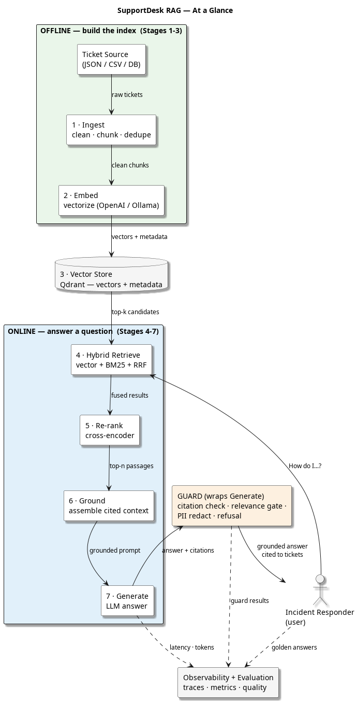

<!--
Copyright (C) 2026 Tonworio (Ton) Oguara
SPDX-License-Identifier: MIT
-->

# From RAG Pipeline to Bounded Agent: Building a Production Support-Desk Assistant

> **Author:** Ton Oguara — Principal Software Engineer
> **Stack:** Python 3.14 · OpenAI (gpt-4o-mini, text-embedding-3-small) or Ollama (local models) · Qdrant · rank-bm25 · sentence-transformers (BAAI/bge-reranker-v2-m3) · SQLite · `uv`
> **Code:** [github.com/tomoguara/sd-agentic-rag](https://github.com/tomoguara/sd-agentic-rag)
> **Audience:** software engineers and AI engineers who know the basics of LLMs — prompts, tool-calling, maybe a few embeddings — and want to see a *real, working* end-to-end RAG system, and then see it grow into an agent without losing its discipline: the actual classes, the actual failure modes, the measured results, and the guardrails that keep it honest. You don't need to know the RAG vocabulary in advance — every term is explained at first appearance. Not a toy.

---

A support desk is a time machine. The question a customer is asking right now has almost certainly been asked before, answered before, and written down — somewhere — in a ticket. The problem is never that the knowledge is missing. It's that the knowledge is *scattered*: half in a ticketing database, half in a CSV, half in a resolution note that no one reads, and a quarter of it is an email address that legally shouldn't be sitting inside a prompt.

Retrieval-Augmented Generation (RAG) is the obvious answer to that: search the past, stuff the relevant pieces into a prompt, let the LLM synthesize — the model answers from *your* evidence, not from its memory alone. And most RAG tutorials stop there — retrieve, stuff, generate — ship it, and discover in week two that the assistant is confidently inventing ticket numbers, echoing the customer's own email address back to them, and answering billing questions with network-troubleshooting context.

This article walks through the design and implementation of **SD Agentic RAG**, a system that answers support questions with *cited* answers drawn from ticket history. The design goal was never "call an LLM." It was: *every claim the system makes has to point at a ticket that actually exists, and the system has to be able to say "I don't know" when the context doesn't support an answer.* That single requirement is what determines most of the architecture that follows.

The article has two parts, because the system was built in two steps:

- **Part 1 — the pipeline.** Seven stages in a line — Ingest, Embed, Store, Retrieve, Re-rank, Ground, Generate — plus one wrapper around the end (a Guard) that enforces citations, a relevance gate, and PII redaction, and a cross-cutting layer of observability and evaluation. Deliberately boring, and it answers most questions well.
- **Part 2 — the bounded agent.** The same seven stages, but the last four run inside a loop that a Planner controls, a Critic and a Self-Review keep honest, Memory feeds, and the Guard still wraps. It handles what a single pass cannot — questions that need two pieces of evidence, follow-ups like "what was its resolution?", and a first retrieval that misses — and it is measured against the pipeline on a golden query set, including the places where it first did *worse*.

Every diagram in this article is reproducible from the PlantUML source in the repo, and every code snippet is lifted (abridged) from the working codebase.

You don't need to be a support-ops person to follow this. The value is in a repeatable pattern for turning "a pile of past tickets" into a grounded, auditable, *honest* answering service — and then letting it think a little harder without letting it make things up.

## High-level overview



That one picture is the whole Part 1 architecture. The rest of Part 1 is about how each box is built, and — more importantly — where the boxes would quietly go wrong if I'd built them the lazy way. Part 2 then puts the last four boxes in a loop.

---

# Part 1 — The pipeline

## 1. Why this shape, and why "a line + a wrapper"

Before writing code, it's worth being clear about what this is *not*. A support-answer assistant is **not** a multi-agent problem. There's no router, no fleet of specialized agents, no merge node. It's a *pipeline* — and that's the right call, because there's exactly one job: **find the evidence, then answer from it**. (Part 2 adds a loop around that job. It still isn't a multi-agent system, and the reasons are the same.)

The decision I'd push back on hardest in a code review is the naive one: *ask a big model to "search the tickets and answer"* and call it done. That conflates two fundamentally different problems — **retrieval**, which is deterministic, testable, and where your bugs should live, and **generation**, which is probabilistic and where hallucination lives — into one undifferentiated LLM call. You lose the ability to unit-test retrieval, to log *which* tickets were considered, and to reject a bad answer *after* it's produced. SD Agentic RAG keeps them separate, and every design choice below falls out of that separation.

Here's the capability list I designed against, straight from the design brief:

1. Answer a customer question with **citations to source tickets**
2. **Triage** an incoming ticket (category + urgency + troubleshooting steps)
3. Find **similar past tickets** to the current issue
4. Generate an **escalation handoff** summary
5. Detect **knowledge gaps** across tickets
6. **Bulk** analyze a batch of tickets
7. **Refuse** — say "I can't answer" — when the context doesn't support it

Capability 7 is the one that most often gets skipped in naive implementations, and it's the one that most separates a demo from a system a support lead will actually trust. A RAG system that *never* says "I don't know" is a RAG system that will, eventually, be wrong with confidence. We'll come back to it in the Guard section — and again in Part 2, where refusing *correctly* turned out to be the hardest thing for the agent to learn.

The two halves map cleanly onto offline/online:

| Half | Stages | When it runs | What it costs |
|---|---|---|---|
| **Offline** (build the index) | 1 Ingest → 2 Embed → 3 Store | When new tickets arrive; batch | Embedding API + storage |
| **Online** (answer a question) | 4 Retrieve → 5 Re-rank → 6 Ground → 7 Generate → Guard | Every customer question | Embedding + LLM + cross-encoder |

That split is the load-bearing structural decision. The offline half runs *as often as your data changes*; the online half runs *as often as you have questions* and has to be fast, cheap, and honest. Keeping them separate is why you can swap the embedding model offline without touching the query path, and why you can test the online half against a *fixed* index. It is also why Part 2 is possible at all: the agent only changes the online half.

The full architecture, including the CLI surface, the retrieval internals (vector index + BM25), the Guard, and the cross-cutting observability/evaluation layer, looks like this:


---

## 2. Stage 1 — Ingest: clean, chunk, dedupe, and attach *metadata*

The unglamorous truth of RAG is that **garbage in is hallucinations out.** Retrieval can only find what was put in the index, and it can only find it *well* if the chunks are shaped so that each one answers a coherent question.

Ingest does four things in order, and the order matters. The implementation is `SdAgenticIngest` in `sd_agentic_ingest.py`:

```python
# src/sd_agentic_rag/sd_agentic_ingest.py (abridged)
class SdAgenticIngest:
    def __init__(self, chunk_size: int = 1000, chunk_overlap: int = 150,
                 chunk_type: str = "recursive",      # "recursive" or "token"
                 chunk_header: Optional[bool] = None):  # None = ingest.chunk_header from config
        self.chunk_size = chunk_size
        self.chunk_overlap = chunk_overlap
        self.chunk_type = chunk_type
        self.chunk_header = chunk_header
```

Four design points from the actual code:

**1. Combine `description` and `resolution_notes` before chunking.** This is the single highest-value ingest decision. The *question* is in the description; the *answer* — the part a future search will want — is usually in the resolution notes. Keep them separate and you index thousands of "I can't login" chunks with no signal about *why* or *how it was fixed*. The code concatenates them:

```python
# sd_agentic_ingest.py, process_tickets (abridged)
ticket_text = ticket.get("description", "")
if ticket.get("resolution_notes") and ticket["resolution_notes"].strip():
    ticket_text += "\n\nResolution: " + ticket["resolution_notes"]
```

**2. PII cleaning — personally identifiable information: email addresses, card-like digit runs, SSNs — is applied *before* chunking.** Tickets are full of email addresses and card-like digit runs. Cleaning before you split means the PII can't straddle a chunk boundary and leak out of a redaction pass you thought had already run. The same pass is applied to the free-text fields that end up in metadata (title, tags). `clean_text` is a small, explicit, regex-only pass — no model in the loop, which is exactly what you want for a deterministic safety step:

```python
# sd_agentic_ingest.py (abridged)
def clean_text(self, text: str) -> str:
    pii_patterns = [
        (r'\b\d{3}-\d{2}-\d{4}\b', '[SSN_REDACTED]'),
        (r'\b\d{16}\b', '[CARD_REDACTED]'),
        (r'\b[A-Za-z0-9._%+-]+@[A-Za-z0-9.-]+\.[A-Z|a-z]{2,}\b', '[EMAIL_REDACTED]'),
    ]
    for pattern, replacement in pii_patterns:
        text = re.sub(pattern, replacement, text)
    text = re.sub(r'\s+', ' ', text).strip()
    return text
```

**3. Recursive chunking at 1000/150 characters, with a ticket header.** `RecursiveCharacterTextSplitter` splits at natural boundaries (paragraphs, lines, sentence ends, commas, spaces) before falling back to hard cuts, so a sentence rarely gets torn mid-thought. A 1000-character chunk (roughly 150–200 words) keeps a full "problem → context → resolution" unit together for a typical ticket; the 150-character overlap ensures a fact that straddles a boundary still survives retrieval. The trade-off is inherent: bigger chunks carry more context but more noise; smaller chunks are more precise but risk splitting a question from its answer. Each chunk is then prefixed with a short header built from *stable* fields — `Title: … | Service: … | Type: … | Tags: …` — so even the second chunk of a long ticket still says what it is about. Volatile fields (status, priority, SLA, assignee, dates) are deliberately kept *out* of the embedded text: they change after indexing, and an embedding can't be patched.

**4. Metadata is attached per chunk and is the actual retrieval contract.** Each chunk carries `ticket_id`, `chunk_index`, and a `metadata` block — `title`, `service`, `severity`, `ticket_type`, `status`, `priority`, `sla_minutes`, `tags`, `assigned_to`, `created_at`, `updated_at`. Notice what is *not* there: the requester's name and email. The ticket's `user` block is read at load time and never copied into the index. Metadata is not decoration: it's what lets Stage 4 filter "only high-severity network tickets," it's what Part 2's agent reads to answer "is it resolved, and what was the SLA?", and it's what the Guard uses to know which ticket IDs are *legally* citable. The `ticket_id` in particular is the thread that runs through everything — it's on the index, in the citation markers, and in the Guard's allow-list.

Deduplication here is deliberately simple — exact-string dedupe on `chunk_text` — because at ingest time you don't have embeddings yet, and semantic dedupe belongs to a later, more expensive pass. Cheap and correct beats clever and slow for a pre-embedding stage.

---

## 3. Stage 2 — Embed: batch it, and don't let one bad batch kill the run

Embedding is where you stop having text and start having data: an *embedding* is the output of an encoding model — a vector of hundreds or thousands of floating-point numbers whose geometry encodes meaning, so that texts with similar meaning land near each other in that space and "find similar tickets" becomes a nearest-neighbor search over vectors. The two engineering requirements are (a) **batch it** so you're not making one API call per chunk, and (b) **be forgiving** so a single failed batch doesn't abort an ingest of thousands of tickets.

`EmbeddingService` in `sd_agentic_embed.py` is a thin OpenAI-compatible client (the same client works against Ollama via a base-URL swap — see §8):

```python
# src/sd_agentic_rag/sd_agentic_embed.py (abridged)
class EmbeddingService:
    def __init__(self, model=None, batch_size=None):
        self.config = Config()
        self.model = model or get_embedding_model_name()
        self.batch_size = batch_size or self.config.get_embed_config().get("batch_size", 100)
        self.dimensions = get_embedding_model_dimensions()   # matches the active model
        self.client = openai.OpenAI(**get_client_kwargs())

    def embed_query(self, query: str) -> List[float]:
        # Instruction-tuned models (e.g. Qwen3-Embedding) expect queries prefixed
        # with a task instruction; documents are embedded as-is
        return self.embed_text(format_query(query, self.model))

    def embed_batch(self, texts: List[str], batch_size: Optional[int] = None) -> List[List[float]]:
        bs = batch_size if batch_size is not None else self.batch_size
        embeddings = []
        for i in tqdm(range(0, len(texts), bs), desc="Embedding batches"):
            batch = texts[i:i + bs]
            try:
                response = self.client.embeddings.create(
                    input=batch, model=self.model, encoding_format="float"
                )
                embeddings.extend([d.embedding for d in response.data])
            except Exception as e:
                print(f"Batch {i//bs} failed: {e}")
                embeddings.extend([[0.0] * self.dimensions for _ in batch])
        return embeddings
```

Three things to note. First, `EmbeddingPipeline.process_chunks` attaches each vector to its chunk **and assigns a UUID if one isn't present** — so the store never has to invent IDs later. Second, the `except` branch pads a zero vector rather than raising. That's a deliberate "log and continue" posture for a batch job: you'd rather ingest 9,999 of 10,000 and see the warning than lose the whole run, and the zero vectors are detectable and re-embeddable. (For an *online* query path you would raise — different failure semantics, different half of the system. That asymmetry is the point of §1.) Third, `embed_query` is not the same as embedding a document: instruction-tuned embedding models such as Qwen3-Embedding expect queries to carry a short task instruction, and without it query-to-document similarity is badly skewed. It is a one-line difference that is easy to miss and expensive to debug.

A subtle correctness detail lives in the store: the embedding **dimension must match the collection**, or Qdrant will reject the upsert. `get_embedding_model_dimensions` in `sd_agentic_store.py` resolves it from the *active* model, in a fixed order:

```python
# src/sd_agentic_rag/sd_agentic_store.py, get_embedding_model_dimensions (abridged)
selector = ModelSelector()
override = selector.get_embedding_dimensions_override()   # OLLAMA_/OPENAI_EMBEDDING_MODEL_DIMM
if override is not None:
    return override
known_dimensions = {
    "text-embedding-3-small": 1536, "text-embedding-3-large": 3072,
    "text-embedding-ada-002": 1536, "nomic-embed-text": 768, "qwen3-embedding": 4096,
}
model_name = selector.get_embedding_model()
if model_name in known_dimensions:
    return known_dimensions[model_name]
...
return _dimension_probe(model_name)   # one-time: embed "probe", measure the vector
```

This matters because the same codebase runs against OpenAI's 1536-dimension `text-embedding-3-small` or Ollama's 4096-dimension `qwen3-embedding` — swap the model and the collection dimension has to swap with it, or every upsert fails. It's the classic "the vector store has a memory you don't share" bug, handled two ways: the dimension is derived from the active model at initialization instead of hard-coded, and (next section) each embedding model gets its *own* collection.

---

## 4. Stage 3 — Store: Qdrant, cosine distance, and metadata as a first-class citizen

Storage is the one stage where the *choice of database* is doing real work, not just holding data. Qdrant is chosen here for three specific reasons the design brief calls out: fast approximate-nearest-neighbor top-k search (its HNSW index), **first-class metadata filtering**, and a clean gRPC/HTTP surface. Filtering is *why* a support RAG uses a vector DB rather than a bare in-process index — you literally cannot ask "only `severity=high`, only `service=network`" in FAISS.

`VectorStore` wraps the qdrant-client and creates the collection with cosine distance — the angle between two vectors, where 1 means same direction and 0 means orthogonal (embeddings are normalized-ish, so cosine is the natural metric). Two details make it safe to live with more than one model. The collection name is **suffixed with the embedding model** (`tickets__qwen3-embedding-latest`, `tickets__text-embedding-3-small`), so switching providers never mixes vectors from two models in one index. And the fields the rest of the system filters on — `ticket_id`, `service`, `severity`, `ticket_type`, `status` — get **payload indexes** at creation time. The piece that makes Stage 4 possible is `filtered_search`, which turns a small set of business filters into Qdrant `FieldCondition`s:

```python
# src/sd_agentic_rag/sd_agentic_store.py (abridged)
def filtered_search(self, query_vector, service=None, severity=None,
                    ticket_type=None, top_k: int = 10):
    conditions = []
    if service:
        conditions.append(FieldCondition(key="service", match=MatchValue(value=service)))
    if severity:
        conditions.append(FieldCondition(key="severity", match=MatchValue(value=severity)))
    if ticket_type:
        conditions.append(FieldCondition(key="ticket_type", match=MatchValue(value=ticket_type)))
    return self.search(query_vector, top_k=top_k, filter_conditions=conditions)
```

That's the whole offline half. Ingest → Embed → Store produces a collection where every point is `(vector, payload)` and the payload carries the `ticket_id` and the metadata the rest of the system depends on. `StorePipeline.store_chunks` builds those payloads from the *same* metadata allow-list Ingest uses (so the two cannot drift), validates dimension parity before upserting, and reports `{stored, failed, skipped, collection, total_points}` so a run is auditable.

---

## 5. Stage 4 — Retrieve: hybrid search, and why RRF is the "don't tune it" answer

**This is the stage that decides whether the system is good.** A semantic retriever alone will happily pull the wrong "password reset" ticket because another ticket was also *about* passwords. A pure keyword retriever alone — BM25 is a classic scoring scheme that measures how *literally* words match — will miss the ticket that answers your question but phrases it differently. In real ticket corpora — full of error codes, version numbers, product names, ticket IDs, and the "service unavailable" vs. "HTTP 503" mismatch — *both* signals matter, and neither is sufficient.

The implementation (`HybridRetriever` in `sd_agentic_retrieve.py`) retrieves from **both** a vector index and a BM25 index, then fuses them with **Reciprocal Rank Fusion**. The BM25 index is built *from the vector store itself* at init — scroll the payloads, build `rank_bm25.BM25Okapi` over the `chunk_text` fields — so there's exactly one source of truth. It keeps each document's payload too, so a passage found *only* by keyword still carries its real `ticket_id` and metadata:

```python
# src/sd_agentic_rag/sd_agentic_retrieve.py (abridged)
def retrieve(self, query, top_k=10, query_embedding=None,
             vector_top_k=None, bm25_top_k=None):
    vector_k = vector_top_k or self.vector_top_k      # default 20
    bm25_k = bm25_top_k or self.bm25_top_k            # default 20

    if query_embedding is None:
        query_embedding = self.embedding_service.embed_query(query)

    # 1. Vector search (semantic)
    vector_results = self.vector_store.search(query_vector=query_embedding, top_k=vector_k)
    # 2. BM25 search (lexical)
    bm25_results = self.bm25_index.search(query, top_k=bm25_k) if self.bm25_index else []
    # 3. Fuse with RRF
    fused_results = self.rrf_fusion(vector_results, bm25_results, k=self.k_rrf)
    return fused_results[:top_k]
```

RRF is the part I want to defend, because "we're just summing inverse ranks" sounds like a cop-out. It isn't — it's *the* standard answer to merging two *rank-ordering* signals whose **scores are on incompatible scales** (a cosine similarity in [0,1] is not comparable to a BM25 score). You cannot add a `0.62` to a `47.3` and call it relevance. RRF sidesteps scale entirely by working on *ranks*:

```python
# sd_agentic_retrieve.py, rrf_fusion (abridged)
# RRF Formula: fused_score(doc) = sum( 1 / (k + rank_i(doc)) )  for each retriever i
for rank, result in enumerate(vector_results, start=1):
    doc_id = result.get("id") or result.get("doc_id")
    if doc_id:
        fused_scores[doc_id] = {"score": 1 / (k + rank), "vector_rank": rank, "bm25_rank": None}

for rank, result in enumerate(bm25_results, start=1):
    doc_id = result.get("doc_id")
    if doc_id:
        if doc_id in fused_scores:
            fused_scores[doc_id]["score"] += 1 / (k + rank)
            fused_scores[doc_id]["bm25_rank"] = rank
        else:
            fused_scores[doc_id] = {"score": 1 / (k + rank), "vector_rank": None, "bm25_rank": rank}

sorted_docs = sorted(fused_scores.items(), key=lambda x: x[1]["score"], reverse=True)
```

Three properties make RRF the right default here. **Parameter-free:** `k=60` is the standard constant, not a knob to tune per corpus. **Robust to a weak retriever:** a document only a mediocre retriever found still scores something; a document both found high scores *double*. **Consensus-rewarding:** the doc that appears in both top lists rises naturally, which is exactly the "two independent methods agree this is the ticket" signal you want. The config sets `k_rrf: 60`, `vector_top_k: 20`, `bm25_top_k: 20` — retrieve generously, fuse, then truncate.

One honest caveat, stated in the design doc: hybrid search adds retrieval latency (you pay for two retrievals) and the in-process BM25 index here is the *demo-grade* implementation. For a corpus in the hundreds of thousands, the brief's recommendation is to move BM25 to a dedicated engine (Elasticsearch/OpenSearch) or Qdrant's native hybrid — the RRF fusion logic stays identical, only the two "retrievers" change. That's the beauty of this stage: **the fusion strategy is decoupled from the retrieval backends**, so you upgrade the backends without touching the correctness of the merge.

---

## 6. Stage 5 — Re-rank: the cross-encoder is precision, not recall

Re-ranking is the "second opinion" stage. The first pass (hybrid + RRF) is a *broad-net* retriever: it's fast, it's good at recall, but it's coarse at ordering. A **cross-encoder** re-scores the *query–passage pairs together*, which is far more precise — and far more expensive. So you never re-rank the whole corpus; you re-rank the candidates the first pass gave you, and take the top-n.

```python
# src/sd_agentic_rag/sd_agentic_rerank.py (abridged)
class ReRanker:
    def __init__(self, model_name=None, min_score: float = -5.0, batch_size: int = 32):
        from sentence_transformers import CrossEncoder
        config = Config()
        self.model_name = model_name or config.get_rerank_config().get("model")
        self.batch_size = batch_size
        self.model = CrossEncoder(self.model_name)   # BAAI/bge-reranker-v2-m3 in config

    def rerank(self, query, documents, top_k=None):
        if not documents:
            return []
        pairs = [(query, _get_document_content(doc)) for doc in documents]
        scores = self.model.predict(pairs, batch_size=self.batch_size)
        for doc, score in zip(documents, scores):
            doc["rerank_score"] = float(score)
        documents.sort(key=lambda x: x["rerank_score"], reverse=True)
        return documents[:top_k]
```

The configured model is `BAAI/bge-reranker-v2-m3`, a multilingual cross-encoder that runs locally — re-ranking adds **no cloud cost**, only a local inference pass (on a CPU, that pass is the slowest part of the online path; Part 2 comes back to this). That's the bi-encoder vs. cross-encoder trade-off made concrete: the vector store's bi-encoder is cheap and independent (encodes query and doc separately), the cross-encoder is expensive and joint (encodes the *pair*). You pay the expensive one only on the short list.

**A detail I'd flag in review:** the re-ranker's score is also the system's first *relevance floor*. bge-reranker scores land on a 0–1 scale, and on this corpus the separation is stark: correct tickets scored between 0.12 and 0.998, off-topic questions at or below 0.0001. So Ground (next section) drops anything below `min_relevance_score: 0.05`, and an off-topic question simply grounds *nothing* — which is what lets the system refuse instead of answering from the least-bad wrong ticket. The threshold is tied to the model's scale: change the re-ranker, re-benchmark the threshold. And re-ranking stays a *switch* (`rerank.enabled`): with it off, the online path falls back to raw hybrid ordering and nothing else breaks.

---

## 7. Stage 6 — Ground: assemble a *cited* context, not a wall of text

This is the stage most RAG systems skip or do badly. The naive version is "join all the retrieved passages with newlines and stuff it in the prompt." SD Agentic RAG's `ContextGrounding` does the job properly, and the reason it matters is that **this output is the contract the LLM is allowed to quote from.**

`ground_context` filters by a minimum relevance score, takes the top-n passages, and wraps each one in a **citation marker** — `[CITATION:ticket_id]` — before concatenating:

```python
# src/sd_agentic_rag/sd_agentic_ground.py (abridged)
def ground_context(self, reranked_results, query=None, embedding_service=None):
    # 1. Filter by minimum relevance score - on the re-ranker's scale only;
    #    un-reranked hybrid results pass through
    relevant_results = [
        r for r in reranked_results
        if "rerank_score" not in r or r["rerank_score"] >= self.min_relevance_score
    ]
    # 2. Sort by rerank_score, then fused_score, then score
    relevant_results.sort(key=lambda x: (x.get("rerank_score", float('-inf')),
                                         x.get("fused_score", float('-inf')),
                                         x.get("score", float('-inf'))), reverse=True)
    # 3. Take top-n
    selected = relevant_results[:self.max_passages]

    context_parts, citations = [], []
    for i, result in enumerate(selected):
        passage = ...    # resolved from payload.chunk_text / chunk_text / document
        ticket_id = ...  # resolved from payload.ticket_id / ticket_id / id
        context_parts.append(f"[CITATION:{ticket_id}]\n{passage}\n")
        citations.append({
            "citation_id": f"[CITATION:{ticket_id}]",
            "ticket_id": ticket_id,
            "score": result.get("rerank_score", result.get("score", 0)),
            "rank": i + 1,
            "retriever": result.get("retriever", "unknown"),
            "content_preview": passage[:100] if passage else "",
        })
    context_text = "\n---\n".join(context_parts)
    return GroundedContext(context_text=context_text, citations=citations,
                           relevance_scores=[c["score"] for c in citations],
                           total_tokens=len(context_text) // 4)
```

Three things in that block are load-bearing:

- **The `citations` list is the allow-list.** It's the same structure the Guard later verifies *against*. The grounding stage decides which ticket IDs exist; the Guard decides whether the answer stayed within that set. Grounding and Guard are two ends of the *same* contract. In Part 2 this becomes the agent's most important invariant.
- **Token budgeting is explicit.** `max_passages: 5`, `max_tokens: 4000`, `min_relevance_score: 0.05`, and a `truncate_context` that drops the lowest-scoring passages first when the context overflows. You're choosing context size, not discovering it.
- **Defensive field resolution.** The code resolves `passage` from several possible locations (`payload.chunk_text`, `chunk_text`, `document`) and `ticket_id` from `payload.ticket_id`, `ticket_id`, or `id` (logging a warning if it has to fall back). That's the code being robust to upstream stages having slightly different shapes — and it's exactly why Part 2's tools could reuse this stage unmodified.

---

## 8. Stage 7 — Generate: a grounded prompt, low temperature, and an explicit *refusal instruction*

The LLM call itself is small. What's not small is the **prompt contract**, because the model is only allowed to do one thing: synthesize the context and attach the citation markers. `AnswerGenerator` encodes that contract in a system prompt (`GROUNDED_SYSTEM_PROMPT`) and uses a low temperature to suppress the "but I *think* there's also…" tail where hallucination lives:

```python
# src/sd_agentic_rag/sd_agentic_generate.py (abridged)
GROUNDED_SYSTEM_PROMPT = """
You are a support desk assistant answering incident tickets.
Your answer MUST be grounded ONLY in the provided context.
Follow these rules STRICTLY:

1. Use ONLY information from the provided context
2. Add citation markers like [CITATION:ticket_id] after each claim
3. If the context doesn't contain enough information, say "I cannot find sufficient information in the ticket data to answer this question"
4. Do NOT invent, infer, or hallucinate information
5. Keep answers concise and actionable
6. If multiple citations support the same point, list them all: [CITATION:ticket1][CITATION:ticket2]
"""

# AnswerGenerator.generate_answer (abridged)
effective_system_prompt = system_prompt or GROUNDED_SYSTEM_PROMPT
user_prompt = f"""Context:\n{context}\n\n---\n\nQuestion:\n{question}\n\nAnswer:"""
response = self.client.chat.completions.create(
    model=self.model_name,
    messages=[{"role": "system", "content": effective_system_prompt},
              {"role": "user", "content": user_prompt}],
    temperature=self.temperature,   # default 0.2
    max_tokens=self.max_tokens,     # default 1000
)
```

Three design choices worth calling out:

- **`temperature=0.2`** (the config default). Not zero — zero on a *generation* call is a different kind of brittleness — but low enough that the model isn't improvising. The *decision* calls in Part 2 (planning, judging evidence) run at temperature zero; the *answer* is at 0.2. Different semantics, different setting.
- **The refusal is a first-class instruction (rule 3), not an afterthought.** This is the capability-7 requirement from §1, *baked into the prompt*. The model is told exactly what to say when it doesn't know. That's the first half of the honest-answers requirement; the Guard in the next section is the second half (it *detects* the refusal and doesn't punish it for having no citations).
- **Token and model tracking ride on the return.** `GeneratedAnswer` carries `prompt_tokens`, `completion_tokens`, `total_tokens`, and `model` — because cost and model are observability inputs, not afterthoughts. In Part 2 those numbers feed a hard budget.

The generator is provider-agnostic via `model_selector`: the same `chat.completions.create` call runs against OpenAI's `gpt-4o-mini` **or** a local model served by Ollama (Ollama exposes an OpenAI-compatible endpoint, so the client code doesn't change — only the base URL and model name do). That's how the design stays model-portable without the model choice leaking into the pipeline: one seam, `get_client_kwargs()`, decides which provider you're talking to. The same seam sets an explicit HTTP timeout and retry count (`HTTPX_TIMEOUT`, default 120 s; `HTTPX_MAX_RETRIES`, default 2) for *every* client — chat, embeddings, the dimension probe. The library's default is to wait up to ten minutes on a hung request, and during testing single hung calls stalled runs for five to ten minutes before a retry succeeded.

---

## 9. The Guard: the stage that makes citations meaningful

This is the stage a naive "retrieve → stuff → generate" system doesn't have, and it's the reason I'd call SD Agentic RAG *production-shaped* rather than demo-shaped. **A model that is told to cite can still cite a ticket that isn't in the context.** A `temperature` setting won't stop it. The only thing that can stop it is a check *after* generation, in deterministic code, that the model can't talk its way past.

`Guardrails` in `sd_agentic_guard.py` runs a fixed sequence of checks on the raw answer, rewrites it for PII, and — when enforcement is on — replaces a blocked answer with the standard refusal:

```python
# src/sd_agentic_rag/sd_agentic_guard.py, process_answer (abridged)
def process_answer(self, answer, question, citations, embedding_service=None):
    result = {"allowed": True, "actions": [], "modified_answer": answer, "checks": {}}

    # Refusal first - it exempts the answer from the count and length checks
    is_refusal = self.check_refusal(answer)

    # 1. Citation check - every cited ticket must exist in the grounded context
    if self.enable_citation_check:
        citation_check = self.verify_citations(answer, citations)
        if not citation_check["valid"]:
            result["allowed"] = False
            result["actions"].append(f"Missing citations: {citation_check['missing']}")

    # 2. Minimum citations - an uncited answer is a hallucination in disguise
    # 3. Length - min/max answer size in tokens            (both skipped for refusals)
    # 4. Relevance gate - cosine(question, answer) >= relevance_threshold
    # 5. Safety filter - harmful-content patterns (off by default)
    # 6. PII redaction - rewrite the answer to strip SSN / card / email / phone
    if self.enable_pii_redact:
        result["modified_answer"] = self.redact_pii(answer)

    # 7. Enforcement - a blocked answer is replaced, not just reported
    result["enforced"] = self.enforce
    result["replaced"] = not result["allowed"] and self.enforce
    if result["replaced"]:
        result["modified_answer"] = STANDARD_REFUSAL
    return result
```

The checks, and why each one is non-redundant:

| Check | What it catches | If it failed, how bad |
|---|---|---|
| **Citation verify** | A `[CITATION:XXX]` where `XXX` ∉ the grounded-context ticket IDs — i.e. the model *invented* a source | A customer told a ticket number doesn't exist. Trust → gone. |
| **Min citations** | An answer with *zero* `[CITATION:]` markers, which can otherwise be fluent prose dressed as a grounded answer | A hallucination that looks like an answer. |
| **Relevance gate** | Answer is fluent and cited but *off-topic* to the question (cosine too low) | Wrong, but confident. |
| **Refusal detection** | The model *correctly* said "I can't answer" — and must **not** be penalized for having no citations | A false positive that blocks a *correct* refusal. |
| **PII redaction** | An email / card / SSN / phone number that slipped into the answer despite Stage 1's clean pass | A data leak in a *response*, not just in the index. |

**Enforcement is the switch that turns a report into a guarantee.** With `guard.enforce: true` (the default), an answer that fails a check is *replaced* by the standard refusal before anyone sees it; with it off, the Guard only reports. Early in the project the checks ran but nothing acted on them — the verdict was logged and the unverified answer was returned anyway. A guard that only writes to a log is an audit trail, not a guard.

The **PII redaction is a second, independent pass** applied to the *answer*, using the same regex table as ingest but extended (it adds `[PHONE_REDACTED]`). This is *defense in depth*: Stage 1 redacts what goes *in*, the Guard redacts what comes *out*. You can have one fail — the model can *echo an email from the user's own prompt* that was never in the corpus — and the other still catches it.

The **refusal logic** is the subtle one. `check_refusal` matches a small set of refusal phrases — but only at the *start* of the answer, after an optional apology:

```python
# sd_agentic_guard.py (abridged)
REFUSAL_PATTERN = re.compile(
    r"^(?:(?:i'?m |i am )?sorry[,.]?\s*|unfortunately,?\s*)?"
    r"(?:i(?:'m|\s+am)?\s+)?"
    r"(?:cannot answer|cannot find|can't answer|can't find"
    r"|no sufficient|not enough information"
    r"|don't know|do not know|unable"
    r"|not applicable|outside my knowledge)"
)

def check_refusal(self, answer: str) -> bool:
    normalized = answer.strip().lower().replace("’", "'")
    return bool(self.REFUSAL_PATTERN.match(normalized))
```

The anchoring matters. An earlier version searched *anywhere* in the answer, so a perfectly good support answer containing, say, "the service cannot find the certificate store" would be classified as a refusal and exempted from the citation requirement. Anchored, a refusal is a refusal, and a fix that mentions "cannot find" is still held to the citation rules.

And the Guard *allows* a refusal even if it has zero citations, because a correct "I don't know" is the *right* output — the system just has to not *punish* the model for being honest. That single branch is the difference between "a RAG that answers everything" and "a RAG that's allowed to say no."

This is the stage I'd most defend in a design review, because it's the stage that **moves the hallucination problem from "the model might do it" to "the model can't do it unobserved."** The LLM is still the one generating; the Guard is the one *verifying*. That separation — model proposes, code verifies — is the whole point of a production RAG, and it's why the Guard is a wrapper, not a prompt trick. It is also the principle Part 2 is built on.

---

## 10. Cross-cutting: observability and evaluation, as a first-class layer

A RAG system you can't *measure* is a RAG system you can't trust after the demo. SD Agentic RAG puts observability and evaluation on equal footing with the pipeline itself — not as an afterthought appended in `finally`, but as stages that *wrap* the others.

**Tracing** is a context manager, `trace_stage`, that logs a structured `{stage, trace_id, event}` record into a JSON logger and — when OpenTelemetry is importable — opens a real span so you can see per-stage timing in a tracing backend:

```python
# src/sd_agentic_rag/sd_agentic_observability.py (abridged)
@contextmanager
def trace_stage(stage_name, extra=None, tracer=None):
    trace_id = str(uuid.uuid4())[:8]
    start_time = time.time()
    logger.info(json.dumps({
        "stage": stage_name, "trace_id": trace_id,
        "event": "start", "timestamp": datetime.now().isoformat()
    }))
    span = None
    if OTEL_AVAILABLE and tracer:
        try:
            span = tracer.start_span(f"rag.{stage_name}")
            span.set_attribute("stage.name", stage_name)
            span.set_attribute("trace.id", trace_id)
        except Exception:
            span = None
    try:
        yield trace_id
    ...
```

That's the whole trick, and it's worth its weight: **the tracing is optional at the import level.** If OpenTelemetry isn't installed, `OTEL_AVAILABLE` is `False`, the `span` stays `None`, and the JSON logging path still works. You can run the pipeline in a minimal environment and add "real" observability later without touching the stage code. The stages don't know whether they're being traced — they just `with trace_stage("retrieve"):`. Part 2's agent reuses exactly this, naming its spans `agent.planner`, `agent.critic`, and so on.

**Metrics** is a `MetricsCollector` (via `RAGPipelineObserver`) that tracks the things that matter in production and that the design brief's KPI table calls out explicitly:

```python
# sd_agentic_observability.py — the API surface the pipeline calls (abridged)
def record_pipeline(self, stage, duration_ms, metadata=None): ...   # per-stage latency
def record_throughput(self, count=1): ...                            # QPS
def record_accuracy(self, eval_set_name, correct): ...               # from the evaluator
def record_cost(self, stage, cost, metadata=None): ...               # $ per stage
def record_hallucination(self, detected, metadata=None): ...         # % unsupported claims
def get_hallucination_rate(self) -> float: ...
def get_total_cost(self) -> float: ...
def get_total_time(self) -> Optional[float]: ...
def get_full_metrics(self) -> Dict[str, Any]: ...
```

`pipeline.get_observability_metrics()` returns the collected metrics after a run, and `pipeline.reset_observability()` clears them — so a single CLI invocation can report its own latency, cost, and stage breakdown without a separate monitoring daemon. That's the kind of observability that fits a CLI tool (which this is) rather than being bolted on.

**Evaluation** — `Evaluator` / `EvaluationPipeline` in `sd_agentic_eval.py` — is the piece that lets you *regress-test* the whole pipeline. It scores each query on `relevance_score`, `answer_quality_score`, `hallucination_score` (lower is better), plus `context_precision` and `context_recall` when you have ground truth. Because it consumes the *same* `GeneratedAnswer` + `citations` structures the pipeline produces, you can score any change against a reference answer:

```python
# sd_agentic_eval.py, evaluate (abridged)
def evaluate(self, query_id, query_text, predicted_answer,
             ground_truth=None, retrieved_context=None, latency_ms=None):
    result = ...
    if ground_truth:
        result.relevance_score = self._evaluate_relevance(query_text, predicted_answer, ground_truth)
        result.answer_quality_score = self._evaluate_answer_quality(predicted_answer, ground_truth)
        result.hallucination_score = self._detect_hallucination(predicted_answer, ground_truth)
    ...
def evaluate_dataset(self, queries, parallel=False) -> EvaluationSummary: ...
def export_results(self, filepath) -> None: ...   # JSON
```

The KPI table the design brief calls out — end-to-end latency < 3s, retrieve-only < 200ms, relevance > 0.8, **citation coverage 100%**, hallucination < 1%, cost < $0.01/query — is the target this API is meant to measure against. These text-similarity scores are a useful smoke test, but they are fuzzy. Part 2 adds a stricter, fully deterministic evaluation built on ticket IDs — because once you are comparing two systems, "the answer reads similar to the reference" is not good enough.

---

## 11. Putting it together: the `sd-agentic-rag` CLI

The pipeline is exposed through a single `sd-agentic-rag` command with subcommands, each a thin wrapper over `SdAgenticRAGPipeline`. The **`answer`** command is the full path — retrieve → re-rank → ground → generate → guard — and returns the answer, its citations, the Guard verdict, and the observability metrics in one JSON/markdown block:

```python
# src/sd_agentic_rag/rag_commands/rag_answer.py (abridged)
def run(self, prompt, config_path=None, top_k=5):
    from sd_agentic_rag import SdAgenticRAGPipeline
    pipeline = SdAgenticRAGPipeline()
    result = pipeline.generate_answer(query_text=prompt, top_k=top_k, ground_enabled=True)
    answer_obj = result.get("answer")
    answer_text = getattr(answer_obj, "answer", "") if answer_obj else ""
    citations = getattr(result.get("grounded_context"), "citations", [])
    guard_result = result.get("guard_result", {})
    return {"prompt": prompt, "answer": answer_text, "citations": citations,
            "metrics": pipeline.get_observability_metrics(),
            "guard": {k: guard_result.get(k) for k in ("allowed", "enforced", "replaced", "actions")}}
```

The other commands are, structurally, the same pattern with a different stage as the terminal:

| Command | Terminal stage it drives | What it's for |
|---|---|---|
| `answer` | Generate + Guard | The full question-answering path (single pass) |
| `agent` | The bounded loop (Part 2) | Multi-part questions, follow-ups, retries — with memory |
| `triage` | Ground (similar-context) | Category + urgency + troubleshooting steps |
| `similar` | Retrieve | Find the past tickets like this one |
| `escalate` | Retrieve + context | Escalation handoff summary |
| `runbook` | Ground | Match an incident to the right runbook |
| `gap` | Retrieve (pattern) | Detect knowledge gaps across tickets |
| `bulk` | Retrieve over a batch | Group tickets by product / symptom |
| `evaluate` | Generate + Guard + Evaluator | Score a query, or a golden set (Part 2) |
| `ingest` / `qdb` | (offline) / (Store) | Reindex, and debug the Qdrant collection |

The architectural payoff of putting **one pipeline** behind **all the commands** is that a *change* to any stage — swap the embedding, change the chunk size, flip re-ranking — propagates to **every** command at once. The CLI is a *view* over the pipeline, not a parallel implementation. That's the property that keeps a RAG system from rotting into a pile of near-duplicate `if/else` branches the moment someone adds another capability — and, as Part 2 shows, it's what let the agent be added without forking the pipeline.

---

# Part 2 — Same seven stages, last four in a loop

## 12. Where a single pass stops

The pipeline answers most questions well, and it answers them in one pass: one retrieval, one grounded context, one generation. That one-pass shape is also its ceiling. Three kinds of question kept falling through it:

- **Questions that need two pieces of evidence.** "Is INC980201 resolved, and what is the status of its follow-up?" needs the incident *and* a different ticket — the follow-up — and one similarity search over the whole question rarely brings back both.
- **Follow-ups.** "What was its resolution?" means nothing on its own. A stateless pipeline has no idea what "it" is.
- **A first retrieval that misses.** If the first search comes back thin, the pipeline has no second chance: it generates from what it has, or refuses.

The tempting fix is to hand the whole thing to an "agent" — give a model some tools and let it figure it out. That throws away everything Part 1 was careful about: retrieval stops being testable, there's no fixed place where evidence is checked, and the Guard turns into a suggestion. So the design question was narrower: **how do you let the system try again, decompose, and remember — without giving up the citation contract, refusal-first behavior, and observability?**

The answer fits in one sentence:

> **Agentic RAG = the same seven stages, but the last four (Retrieve → Re-rank → Ground → Generate) run inside a loop that a Planner controls, a Critic and a Self-Review keep honest, Memory feeds context, and a Guard wraps it all.**

The offline half (Ingest → Embed → Store) is untouched. The base `answer` command is untouched and stays the baseline. The new `agent` command reuses the *same* stage objects — the same retriever, re-ranker, grounder, generator, and guardrails — and adds a small set of named components around them.

## 13. The shape: named boxes, one job each


| Component | Job |
|---|---|
| **Planner** | Splits the question into *sub-goals*, each answered by one tool call; refines them when evidence is missing. LLM by default, with a deterministic fallback. |
| **Tools** | Exactly three, all retrieval: `retrieve` (hybrid search), `lookup` (fetch a ticket by ID), `filtered_retrieve` (hybrid search restricted by service, severity, ticket type, or status). |
| **Ground** | Unchanged `ContextGrounding`, applied per sub-goal and merged. Its citation list is still the only source of citable ticket IDs. |
| **Critic** | *Before* generation: is the grounded evidence enough for every sub-goal? |
| **Self-Review** | *After* generation: is every citation in the allow-list, and are enough sentences cited? |
| **Guard** | The wrapper: PII redaction of everything that enters the loop, a hard budget, the same final-answer guardrails as `answer`, and a per-step trace. |
| **Memory** | One SQLite file: the thread's conversation, an append-only audit of every step, and hints from past resolutions. |

The orchestration is a plain Python loop — no agent framework, no tool-calling protocol. The LLM is consulted *inside* the Planner, the Critic, and (optionally) the Self-Review, through a single JSON-call helper; control flow is code. That choice is what makes the invariant enforceable:

> **Bounded autonomy.** The agent may choose *which* tool to call and *how many times*, but it can never skip Ground, add citable evidence, override a deterministic gate, exceed the budget, or call a tool outside the fixed registry. Autonomy lives in *order and repetition*, never in *invention*.

And there is a reduction that keeps the whole thing honest: **with one iteration, the agent *is* the pipeline.** `--max-iterations 1` forces the deterministic "retrieve once" plan, and with memory off, a unit test asserts that the agent grounds and cites exactly the same tickets as `answer` for the same question. The pipeline from Part 1 isn't replaced; it's the 1× case of the loop.


Here is the core of one turn, from `AgenticRAGLoop.run_turn()`:

```python
# src/sd_agentic_rag/agent/loop.py, run_turn (abridged)
plan = planner.plan(q, context, budget=budget,
                    force_heuristic=cfg.budget.max_iterations == 1)
while final is None:
    iteration = budget.start_iteration()          # raises BudgetExceeded at the limit
    for goal in plan.open_sub_goals:
        budget.check()
        evidence = guard.redact_evidence(self.tools[goal.tool].run(goal, goal.top_k or cfg.top_k))
        pool.add(goal.id, evidence)               # evidence accumulates across iterations

    grounded = ground_pool(self.pipeline.ground_pipeline, pool, {g.id: g.query for g in plan.sub_goals})
    verdict = critic.judge(q, plan, grounded, pool, budget=budget)
    if not verdict.sufficient:
        plan = self._refine(planner, q, plan, verdict, context, budget, executed, trace)
        continue

    while True:                                   # generate, review, revise once
        draft = self._generate(q, grounded, budget, trace, feedback)
        review = self_review.check(draft, grounded, budget=budget)
        if review.passed:
            final = guard.finalize(draft, q, grounded, relevance_question=...)
            break
        if not budget.can_revise():
            break
        budget.record_revision()
        feedback = review.reasons
    ...
# On BudgetExceeded: one reserved best-effort draft over all grounded evidence,
# gated like any other, returned as `partial` - or the standard refusal.
```


## 14. Planner and tools: decomposition with a fixed toolbox

The Planner's output is a list of sub-goals — `{id, query, tool, filters, ticket_id}` — capped at four. "Is LAT001234 resolved and what was its SLA?" becomes a single `lookup` of LAT001234. "Disks filled up in the backup server, the Prometheus server and the order service — how was each fixed?" becomes three `retrieve` sub-goals, one per service.

The LLM proposes the plan, but code decides whether it's allowed:

```python
# src/sd_agentic_rag/agent/tools.py (abridged)
ALLOWED_TOOLS = ("retrieve", "lookup", "filtered_retrieve")
FILTER_FIELDS = ("service", "severity", "ticket_type", "status")

def validate_sub_goal(sub_goal: SubGoal) -> None:
    if sub_goal.tool not in ALLOWED_TOOLS:
        raise PlanValidationError(f"tool {sub_goal.tool!r} is not allowed")
    validate_filters(sub_goal.filters or {})
    if sub_goal.tool == "lookup":
        if not sub_goal.ticket_id or not TICKET_ID_RE.fullmatch(sub_goal.ticket_id):
            raise PlanValidationError(f"lookup {sub_goal.id!r} needs a ticket_id like LAT001234")
```

If the model returns something that isn't JSON, names a tool like `web_search`, or filters on a field like `assigned_to`, the plan is rejected and the **deterministic planner** takes over — a lookup for every ticket ID in the question, a filtered retrieve when the question names a known service, severity, or ticket type, otherwise one plain retrieve — and the trace records `planner_fallback`. Every LLM-driven decision in the agent has a deterministic fallback like this one; every gate that *verifies* is deterministic to begin with.

Two tool details turned out to matter more than expected:

- **Every piece of evidence starts with the ticket's state.** Before a passage reaches Ground, the tool prefixes it with a line like `Status: Resolved | Priority: P1 | Severity: High | SLA: 240 min | Assigned: Database Team`, rendered from the payload metadata. That's why the agent can answer "is it resolved, and what was its SLA?" *with a citation*: the state facts arrive inside a passage that carries the ticket's ID, so citing them goes through the same allow-list as everything else. (Recall from §2 that these volatile fields are *not* in the embedded text — they live in the payload, and the tool reads them at query time.)
- **`retrieve` is literally the `answer` path.** The retrieve-then-re-rank step was extracted from the pipeline into a shared helper that both `answer` and the agent's `retrieve` tool call, so the two cannot drift. That's what makes the 1× equivalence test meaningful.

## 15. Ground, across sub-goals and iterations

Evidence accumulates in an *evidence pool* for the whole turn. On each iteration, the pool is grounded **per sub-goal** with the unmodified `ContextGrounding`, then merged and truncated to the token budget. Grounding per sub-goal matters: if you ground everything together, the sub-goal with the strongest scores crowds out the others, and "status *and* follow-up" quietly becomes "status." Per sub-goal, each part keeps up to `max_passages` of its own evidence.

The merged citation list is the turn's allow-list — and it is the *only* thing that can be cited. Nothing from memory, earlier turns, or the model's own knowledge is citable; if a ticket wasn't grounded in *this* turn, citing it fails Self-Review.

## 16. Two gates: the Critic before, the Self-Review after

**The Critic** decides whether to generate at all. It has three modes:

- `llm` (default) — an LLM judge returns `{"sufficient", "covered", "missing", "refine_hint"}`, telling the Planner exactly which sub-goal needs more work and why.
- `heuristic` — for each sub-goal, at least one grounded passage whose stored vector has cosine ≥ 0.5 with the sub-goal's query (no extra embedding calls: passage vectors come from the store). A lookup sub-goal counts as covered when its ticket is grounded.
- `both` — sufficient only if both agree.

Before any of that, a pre-check that needs no model at all: **if nothing was grounded, the evidence is insufficient**. Off-topic questions never pay for an LLM judgment.

The Critic is the right place for an LLM — "the evidence covers the status but not the SLA" is a semantic judgment — precisely because its mistakes are caught downstream by deterministic checks. If the judge fails or returns garbage, the heuristic verdict is used and the trace records `critic_fallback`. Note what the Critic *can't* do: it returns a verdict, never evidence. Whatever it says, the allow-list is still whatever Ground produced.

**The Self-Review** checks the draft, and its default mode is fully deterministic: every citation must be in the allow-list, there must be at least one, and at least half of the substantive sentences (four or more words) must carry a citation marker. A refusal passes. If a draft fails, it is regenerated *once* from the same evidence with the failure reasons appended to the prompt; if that fails too, control goes back to the Planner.

```python
# src/sd_agentic_rag/agent/self_review.py, SelfReview.deterministic (abridged)
if self.guardrails.check_refusal(draft):
    return GateVerdict(gate="self_review", passed=True, mode="heuristic", reasons=["refusal"])
reasons = []
check = self.guardrails.verify_citations(draft, grounded.citations)
if not check["valid"]:
    reasons.append(f"cites tickets not in the grounded evidence: {', '.join(check['missing'])}")
if len(check["answer_citations"]) < self.config.min_citations:
    reasons.append(...)
ratio = cited_sentence_ratio(draft)
if ratio < self.config.min_cited_sentence_ratio:
    reasons.append(f"only {ratio:.0%} of sentences are cited ...")
```

There is an optional LLM groundedness check ("list any claims the passages don't support"), but it runs only *after* the deterministic checks pass. It can fail a draft; it can never pass one. That ordering — tighten-only — is how you add an LLM to a verification step without letting it overrule code.

## 17. The Guard as the wrapper: redaction, budget, and an honest `partial`

The Guard in Part 1 wrapped the end of the pipeline. In the loop, it wraps *everything*:

- **Redaction on the way in.** The question and every evidence item are PII-redacted before they reach a Planner, Critic, or Generate prompt, the trace, or memory. The final answer still goes through the base guardrails exactly as in `answer` — same enforcement, same refusal handling, same output redaction.
- **A hard budget.** Every turn is capped: 3 iterations, 12 LLM calls, 20,000 tokens, 120 seconds of wall clock, 1 revision per iteration. The budget is checked before every tool call, every LLM call, and every iteration.
- **An honest exhaustion path.** When a limit is hit before any draft passed, the loop doesn't just give up. One generate call is *reserved* for this moment: it drafts a best-effort answer from all evidence grounded so far, runs it through Self-Review and the Guard like any other draft, and — if it passes — returns it flagged `partial: true` with the stop reason. If it doesn't pass, or nothing was ever grounded, the user gets the standard refusal. The reservation means the worst case is exactly `max_llm_calls + 1` LLM calls, and a unit test asserts it.
- **A per-step trace.** Every plan, tool call (with the ticket IDs it returned), grounding result, verdict, draft, fallback, and budget event is recorded. `--verbose` prints it per iteration; `--json` returns it; memory persists it.

```text
### Iteration 1
- Tool g1 lookup -> INC980201 (1 passages)
- Tool g2 lookup -> INC980301 (1 passages)
- Grounded: INC980201, INC980301
- Critic (llm): insufficient - missing g2 | hint: search for follow-up work related to INC980301
- Refined plan (llm): g1 lookup "INC980201" (done); g2 retrieve "What follow-up work is related to INC980301?"

### Iteration 2
- Tool g2 retrieve -> PRB980302, CHG980102, CHG980202, ...
- Grounded: INC980201, PRB980302, CHG980102, CHG980202, INC980301
```

That's a real trace excerpt. When an agent's answer surprises you, that trace is the difference between "the model did something" and "the Critic judged sub-goal g2 missing, so the Planner re-queried."

## 18. Memory: context for the Planner, never evidence

Memory lives in one local SQLite file and has three parts:

- **Thread conversation.** Each turn's question, answer, and cited ticket IDs are saved under a thread ID. On the next turn, the Planner gets the last few turns, so "What was its resolution?" in thread `demo` plans a lookup of the ticket the previous answer cited — even in a separate process, hours later. `--new` starts a fresh conversation in the thread; earlier turns stay stored.
- **An append-only step audit.** Every trace event, with thread, turn, iteration, and timestamp. There is deliberately no API to update or delete a step; `--audit` prints the lot.
- **Past resolutions.** When an answer passes every gate with at least one verified citation, the question's embedding and its cited ticket IDs are stored. A similar question later — in *any* thread — gets those ticket IDs as Planner *hints*. Each entry records the embedding model that produced its vector, and only entries from the active model are searched; switch providers and old hints are simply ignored instead of being compared across incompatible vector spaces.

The rule that keeps memory safe is the same rule as everything else: **memory is never evidence.** A remembered ticket ID can only become a *lookup*, and the lookup's result has to pass Ground in the current turn before anything can be cited. If the ticket has since been deleted from the index, the lookup returns nothing and the ticket can't be cited — a unit test checks exactly that. And everything written to memory is PII-redacted first.

The thread-memory strategy — a thread ID, a short window of recent turns given to the router, an append-only step history, `--new` and `--audit` — comes from an earlier project of mine, [smart-traveler](https://github.com/tomoguara/smart-traveler). The mechanism there was a LangGraph checkpointer; here it is a few hundred lines of plain `sqlite3`.

## 19. Measuring it: a golden set, and what it caught

"The agent feels smarter" is not a result. To compare the agent against the pipeline, I built a small, deliberately adversarial evaluation set:

- **14 curated demo tickets** added to the corpus: incident/follow-up pairs ("Follow-up to INC980101: replication lag alerting"), tickets with distinct statuses and SLAs, and the *same symptom in different services with different fixes* (a full disk on a backup server, a Prometheus server, and an application host).
- **21 golden queries**, each tagged by what it needs: `1x` (one retrieval suffices), `2x` (two pieces of evidence), `nx` (three or more), and `unanswerable` (must refuse — a cafeteria menu, a nonexistent ticket ID). Each lists the ticket IDs a correct answer should cite.

The metrics are deterministic — no LLM judge, no text similarity — because they are computed from ticket IDs:

| Metric | Definition |
|---|---|
| Citation recall | cited ∩ expected, divided by expected |
| Citation precision | cited ∩ expected, divided by cited (1.0 when nothing is cited and nothing is expected) |
| Refusal correctness | refused an `unanswerable` query, or answered any other |
| Loop cost | iterations, LLM calls, tokens, latency, share of `partial` answers |

"Cited" means ticket IDs in the returned answer *that are also in the grounded allow-list*. One command runs every query through both systems, with agent memory off so runs are independent:

```bash
sd-agentic-rag evaluate --golden-file data/eval/agentic_golden.json --compare --export results.json
```

### The results

Single-pass `answer` → bounded agent, on the same index, per provider:

| Tag | Recall, local (Ollama) | Recall, OpenAI | Refusal correctness, local | Refusal correctness, OpenAI |
|---|---|---|---|---|
| 1x | 1.00 → 1.00 | 1.00 → 1.00 | 1.00 → 1.00 | 1.00 → 1.00 |
| 2x | 0.64 → **0.93** | 0.64 → **1.00** | 0.71 → **1.00** | 0.71 → **1.00** |
| nx | 0.88 → 0.88 | 0.88 → 0.88 | 1.00 → 1.00 | 1.00 → 1.00 |
| unanswerable | — | — | 1.00 → 1.00 | 1.00 → 1.00 |
| **all** | 0.82 → **0.94** | 0.82 → **0.97** | 0.90 → **1.00** | 0.90 → **1.00** |

*Local: `qwen3-coder-next` (chat) with `qwen3-embedding` via Ollama. OpenAI: `gpt-4o-mini` with `text-embedding-3-small`. Same golden set, same corpus, re-ranking on.*

The `2x` row is where the agent earns its keep. Two queries show it best: asked for "the status and SLA of ACC980601 and of PRF980801," and "is SEC980701 resolved and what was its SLA?", the pipeline *refused both* — a similarity search over the question doesn't reliably surface two specific tickets — while the agent planned two lookups, grounded both tickets with their state lines, and answered with citations. On the `1x` questions the agent matches the pipeline, at a cost: about 3 LLM calls per turn instead of 1. Citation precision stayed at 0.95–1.00 for the agent everywhere. On `nx`, the agent matches the pipeline on recall rather than beating it — and with OpenAI, two of those four answers came back flagged `partial` after the budget ran out, still citing the expected tickets.

A caveat I'd put in any review: 21 queries is a *regression harness*, not a benchmark. It demonstrates the mechanism and catches regressions; it doesn't prove general quality. The thresholds are sensible defaults, not calibrated values.

### What the golden set caught

The numbers above are the *final* ones. The first run looked very different: the agent was clearly better on `2x` and clearly **worse** on `nx` — on the local models, recall 0.50 and refusal correctness 0.50 against the pipeline's 0.88 and 1.00 (0.62 and 0.75 with OpenAI). Each failure traced back to a specific, fixable design gap — the most useful part of the whole exercise:

1. **A "sufficient" verdict followed by a refusal.** The LLM Critic judged partial evidence sufficient, the generator — correctly — refused, and Self-Review passes refusals by design. The turn ended in "I don't know" with budget to spare. **Fix:** a refusal drafted after a "sufficient" verdict is treated as *insufficient* evidence for every sub-goal while iterations remain, and control returns to the Planner. On the last iteration, the refusal stands.
2. **Follow-ups that failed the relevance gate.** "What was its resolution?" looked up the right ticket and produced a correct, cited answer — and the Guard replaced it, because the cosine between the bare question and the answer was 0.35. The question doesn't say what it's about. **Fix:** when a turn resolves a ticket remembered from the conversation, the relevance gate compares the answer with the *previous question plus the current one*. Citations, enforcement, and what gets stored still use the real question.
3. **Follow-up tickets nobody searched for.** For "what follow-up work came out of INC980201 and INC980301?", the Planner looked up both parent tickets; the Critic correctly said the follow-ups were missing; and a lookup can't be broadened, so the follow-up tickets — whose text literally says "Follow-up to INC980201" — were never searched for. The LLM Planner made it worse by re-issuing the same lookup with reworded queries. **Fix:** a missing lookup is broadened into a hybrid retrieve of *"ticket ID + sub-goal query"* (BM25 matches the ID inside the follow-up), and a repeated tool call is recognized by what determines its result — a lookup by its ticket ID alone — so rewording no longer counts as trying something new.
4. **A wall clock calibrated for the wrong hardware.** With the first three fixed, the remaining `nx` misses all had the same signature: the turn hit the original 60-second budget. Questions with three or four sub-goals take 40–75 seconds per turn here, mostly in the CPU-bound cross-encoder, so whether they finished depended on timing noise. Lowering the Guard's relevance threshold — the obvious suspect — changed nothing. **Fix:** a 120-second default. The iteration, call, and token limits still bound the work; the wall clock is a backstop, alongside the HTTP timeout.

Not one of those is exotic. They are the ordinary ways an agent fails in practice: a judge that's too generous, a check that assumes a self-contained question, a tool that can't be retried, a budget set without measuring. None of them would have shown up in a demo. All of them showed up as soon as a golden set ran against both systems.

## 20. The `agent` command

```bash
# Single turn, with a per-iteration trace
sd-agentic-rag agent --prompt "Is LAT001234 resolved and what was its SLA?" --verbose

# A follow-up in a thread - works across separate processes
sd-agentic-rag agent --thread-id demo --prompt "Why was outbound email stuck in the SMTP relay queue?"
sd-agentic-rag agent --thread-id demo --prompt "What was its resolution?"

# Interactive chat, the thread's conversation, and every stored step
sd-agentic-rag agent --chat --thread-id demo
sd-agentic-rag agent --history --thread-id demo
sd-agentic-rag agent --audit --thread-id demo --full

# The base pipeline's cost and behavior, with no memory, as JSON
sd-agentic-rag agent --prompt "Why are API calls slow?" --max-iterations 1 --no-memory --json
```

Every turn reports its citations (ticket, score, retriever, and the tool that found it), the Guard verdict, whether the answer is `partial`, and a loop summary: iterations, LLM calls, tokens, elapsed time, and stop reason. An answer, a partial answer, and a refusal all exit 0; only an internal error — Qdrant unreachable, say — exits non-zero. A refusal is a result, not a failure.

---

## 21. What it does today, and where it stops

Being honest about the boundaries is part of the design.

**What's production-ready:** deterministic, *tested* ingest→store with PII kept out of the index; hybrid retrieval that's decoupled from its backends; a re-ranker whose score doubles as a benchmarked relevance floor; a Guard that blocks fabricated citations, redacts PII in the output, and *replaces* what it blocks; a bounded agent whose every autonomous decision has a deterministic fallback and whose every verification is deterministic; memory that informs planning but can never be cited; and a golden-set evaluation that compares the two systems on ticket IDs, not vibes. The model choice is a single seam, and the same code runs on a laptop with local models or against a cloud provider.

**Where it stops / what I'd do next:**

- **The Guard's relevance threshold is uncalibrated across embedding models.** It's a single cosine threshold (0.5), and cosine distributions differ by model: on the local embedding model one correct, cited answer scored 0.474 and was replaced. Calibrating the base Guard — per model, against a larger labelled set — is its own project, not a tweak.
- **The LLM Critic is generous on easy questions and stubborn on hard ones.** On some `nx` questions it kept asking for more until the budget ran out (that's where the `partial` answers come from). It's configurable (`heuristic` or `both` for stricter behavior), but the defaults are untuned.
- **The golden set is small.** Twenty-one queries catch regressions and demonstrate the mechanism. A real quality claim needs a few hundred labelled queries from real traffic.
- **The agent costs more.** About 3–4 LLM calls and 20–25 seconds per turn on average here, against one call for the pipeline. `--max-iterations 1` is there for exactly the questions that don't need more.
- **The re-ranker is generic and CPU-bound.** `bge-reranker-v2-m3` works well out of the box on this corpus, but it's not tuned to it, and on a CPU it's the single biggest latency cost in the agent's multi-sub-goal turns. A GPU or a smaller domain-tuned model is the obvious next step.
- **BM25 is in-process, and PII redaction is regex.** Both are correct and tested, and both have well-known upgrades — a dedicated search engine or Qdrant's native hybrid search; a PII classifier behind the same Guard hook.
- **The tools are retrieval-only.** The design generalizes to calculators, APIs, or code execution, but every tool would need the same property the retrieval tools have: its output must be ticket-attributed and pass through Ground before it can be cited. That constraint is the point, so I'd add tools slowly.

---

## 22. Lessons that will save you time

From the pipeline:

1. **Separate retrieval from generation, and keep them separable.** The moment they're fused into one LLM call, you lose unit-testable retrieval, loggable context, *and* the ability to reject the answer after it's generated. The Guard only exists because generation is a distinct, inspectable stage.
2. **The citation marker is the backbone — and the *allow-list* is what makes it meaningful.** `[CITATION:ticket_id]` is trivial in a prompt; it only has force when a downstream check compares the answer's citations against the grounded context's ticket IDs. Model proposes, code verifies.
3. **PII must be redacted in *two* places — in (ingest) and out (Guard).** The model can echo an email address from the *user's prompt* that was never in your corpus. One pass is not enough.
4. **Refusal is a feature, and the Guard must not punish it — or confuse it.** A model that says "I can't answer" with zero citations is the *correct* output. But detect it narrowly (at the start of the answer), or a real answer that mentions "cannot find" escapes your citation checks.
5. **A guard that only reports is a log.** Enforcement — replacing a blocked answer — is what makes the checks mean anything.
6. **Make the model a seam, not a design parameter — and give the seam a timeout.** `get_client_kwargs()` is the only place a provider appears. Swap OpenAI for Ollama and the pipeline doesn't know.

From the agent:

7. **Put autonomy in order and repetition, never in invention.** Let the LLM choose which tool to call and how often. Don't let it choose what counts as evidence, whether a gate passed, or how long to keep going.
8. **Every LLM decision needs a deterministic fallback; every verification should be deterministic.** An LLM can tighten a check. It should never be able to loosen one.
9. **Keep the 1× case equal to the pipeline, and test it.** It's the cheapest proof that the loop added capability without changing the baseline's behavior.
10. **Memory should steer, not testify.** Remembered ticket IDs are planning hints; they become evidence only by being re-fetched and re-grounded in the current turn.
11. **Budget the loop, and reserve the last call for an honest answer.** A hard stop that still returns a gated, clearly flagged `partial` answer is far more useful than a timeout.
12. **Run a golden set before you trust the agent — and expect it to be worse somewhere.** Mine was worse on exactly the questions the agent was built for. Each failure was a small, targeted fix once it was visible — and invisible without the harness.

---

## Closing

A support-desk RAG is a good test of whether you can hold a *grounded* system together under real constraints: scattered knowledge, PII you can't leak, an LLM that wants to confide, and a support lead who will *not* trust an answer they can't trace to a ticket. The answer, in this codebase, starts as seven small modules in a line, one Guard wrapper that turns "the model *might* be honest" into "the model *can't* be dishonest unobserved," and one cross-cutting layer that makes the whole thing *measurable*.

Making it agentic didn't require a different architecture. It required putting the last four stages in a loop and being strict about who is allowed to decide what: the model plans, re-queries, and judges coverage; code decides what is evidence, what is citable, what passes, and when to stop.

*Ingest → Embed → Store → [ Plan → Retrieve · Re-rank · Ground → Critic → Generate → Self-Review ] ×N → Guard, with Memory feeding the Planner and observability threading the whole thing.*

If your product asks an LLM to answer from a corpus *you own*, and those answers have to be traceable and safe, you probably don't need a bigger model or an agent framework. You need a pipeline, a Guard — and, when one pass isn't enough, a loop with a budget and a golden set to keep it honest.

---

### Appendix A — Reproducing the diagrams

Every diagram in the article is PlantUML. The sources live under `docs/images` in the repository:

| File | Shows |
|---|---|
| `sd_agentic_rag_high_level_overview.puml` | Offline (Ingest/Embed/Store) → Vector Store → Online (Retrieve/Re-rank/Ground/Generate) → Guard → user, with observability + evaluation |
| `sd_agentic_rag_full_system_dataflow.puml` | The full data flow, including the CLI surface, the retrieval internals (vector + BM25), the Guard, and the external model providers |
| `agentic_loop_components.puml` | The agentic loop's components, the Guard wrapper, and memory |
| `agentic_loop_sequence.puml` | One turn: Planner, tools, Ground, Critic, Generate, Self-Review, exhaustion |
| `agentic_loop_family.puml` | 1× / 2× / Nx as the same loop with different iteration counts |

Render with any PlantUML distribution, or with Docker:

```bash
plantuml -tpng docs/images/*.puml
# or
docker run --rm -v "$PWD/docs/images:/data" -w /data plantuml/plantuml -tpng *.puml
```

### Appendix B — Where to read and run it

The code is at [github.com/tomoguara/sd-agentic-rag](https://github.com/tomoguara/sd-agentic-rag). It runs as the `sd-agentic-rag` CLI:

```bash
# Stand up the vector DB
./scripts/qdrant-db.sh --start

# Ingest the ticket corpus, including the curated demo tickets (offline)
uv run sd-agentic-rag ingest --data-path data/merged_tickets.json --wipe

# Answer in a single pass, fully grounded and cited
uv run sd-agentic-rag answer --prompt "How do I reset my password?" --top-k 5 --json

# Answer through the bounded agent, with a per-iteration trace
uv run sd-agentic-rag agent --prompt "Is INC980201 resolved, and what is the status of its follow-up?" --verbose

# Compare the two on the golden set
uv run sd-agentic-rag evaluate --golden-file data/eval/agentic_golden.json --compare --export results.json
```

Model selection lives in `sd-agentic-rag.cfg` (`USE_OLLAMA_MODELS=true` for local models through Ollama, `false` for OpenAI); API keys go in `.env`. The codebase is a standard `src/` Python package under `uv`: `uv sync`, then `uv run pytest` — the unit tests run offline with stubbed models, retriever, and store, no network and no Qdrant required. The live functional tests (`scripts/run_functional.sh`) run the same suite against both providers.
